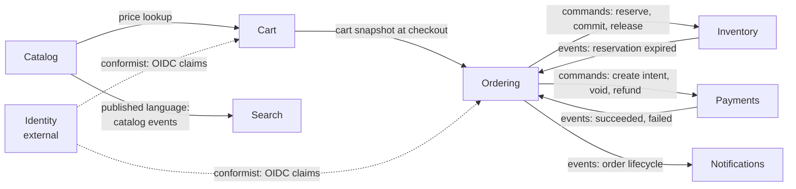

# Context Map — Sagamart

| | |
|---|---|
| **Owner** | Rizky |
| **Status** | Draft |
| **Last updated** | 2026-10-21 |

This document defines Sagamart's bounded contexts, the language each one uses, what it owns, and how contexts relate. When a term means different things in two contexts, each context's definition wins inside that context.

## 1. Bounded contexts

## 2. Context definitions

### Catalog
- **Purpose:** what we sell and for how much.
- **Owns:** products, variants (SKUs), categories, prices, images.
- **Key terms:** *Product* (a sellable item), *SKU* (a specific variant with its own stock), *List price*.
- **Service:** Catalog + Cart (NestJS).

### Cart
- **Purpose:** what a buyer intends to buy.
- **Owns:** carts and cart lines.
- **Key terms:** *Cart* (per guest token or user ID, 7-day TTL), *Cart line* (SKU + quantity + price seen).
- **Note:** a cart line's price is a *snapshot*; the authoritative price is re-read at checkout.
- **Service:** Catalog + Cart (NestJS). Separate context, same deployable, separate tables/store.

### Ordering
- **Purpose:** turn intent into a committed purchase, and coordinate checkout.
- **Owns:** orders, order lines, saga instances and their step history.
- **Key terms:** *Order* (immutable lines once placed), *Order status*, *Checkout saga*.
- **Order status (customer-visible):** `PENDING → AWAITING_PAYMENT → PAID → CONFIRMED → SHIPPED → DELIVERED`, with `CANCELLED` as the terminal failure status.
- **Saga state (internal):** the checkout orchestrator's own progress (`RESERVING_STOCK`, `COMMITTING_STOCK`, `REFUNDING`, `NEEDS_ATTENTION`, ...). It is not shown to buyers. Mapping in [System Design §5](system-design.md#order-status-vs-saga-state).
- **Service:** Order (Java).

### Payments
- **Purpose:** take money exactly once and account for it.
- **Owns:** payment intents, provider transactions, ledger entries.
- **Key terms:** *Payment intent* (one per order; idempotency key = order ID), *Ledger entry* (double-entry, append-only), *Reconciliation*.
- **Service:** Payment (Go).

### Inventory
- **Purpose:** know what can be sold and never sell more than that.
- **Owns:** stock levels per SKU and reservations.
- **Key terms:** *On hand*, *Reserved*, *Available = on hand − reserved*, *Reservation* (temporary hold with TTL), *Commit* (reservation becomes a sale).
- **Service:** Inventory (Go).

### Search
- **Purpose:** find products quickly.
- **Owns:** the search index (a read model; rebuildable from Catalog events).
- **Service:** Event workers (Go).

### Notifications
- **Purpose:** tell buyers what happened.
- **Owns:** notification log, delivery attempts.
- **Service:** Event workers (Go).

### Identity (external)
- Provided by Casdoor or Keycloak via OIDC. Sagamart conforms to its user ID and role claims.

## 3. Relationships

| Upstream | Downstream | Relationship | Contract |
|---|---|---|---|
| Catalog | Search | Published language | `catalog.product.*` events |
| Catalog | Cart | Customer–supplier | Internal price/SKU lookup API |
| Cart | Ordering | Customer–supplier | Cart snapshot passed into `CreateOrder` |
| Ordering | Inventory | Customer–supplier (Ordering is customer) | gRPC `ReserveStock`, `CommitReservation`, `ReleaseReservation` |
| Ordering | Payments | Customer–supplier | gRPC `CreatePaymentIntent`, `VoidPaymentIntent`, `RefundPayment` |
| Payments | Ordering | Published language | `payment.*` events |
| Inventory | Ordering | Published language | `inventory.reservation.expired` |
| Ordering | Notifications | Published language | `order.*` events |
| Identity | All | Conformist | OIDC token claims |
| Mock payment provider | Payments | Anti-corruption layer | Provider adapter maps provider statuses to Sagamart statuses |

## 4. Ubiquitous language: terms that differ by context

| Term | In Catalog | In Inventory | In Ordering |
|---|---|---|---|
| *Item* | A product or SKU on display | A SKU with stock counts | An order line |
| *Available* | Shown as in/out of stock | On hand − reserved | — |
| *Price* | Current list price | — | Price locked at order placement |
| *Cancelled* | — | Reservation released | Order terminal state |

## 5. Rules

1. A context never reads another context's database. The only exception is the read-only invariant checker, a test tool that runs only in test environments (see [testing strategy](../engineering/testing-strategy.md)).
2. A context may cache data from another context, but must say where it came from and how stale it can be.
3. Events are facts in the past tense (`order.confirmed`), commands are imperative (`ReserveStock`).
4. Changing a published event or API is a contract change: it needs an RFC or ADR and a version bump.
