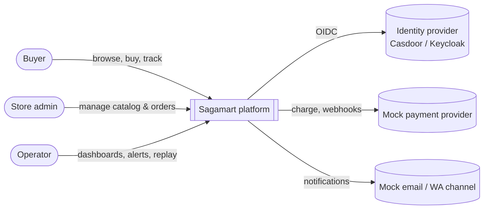
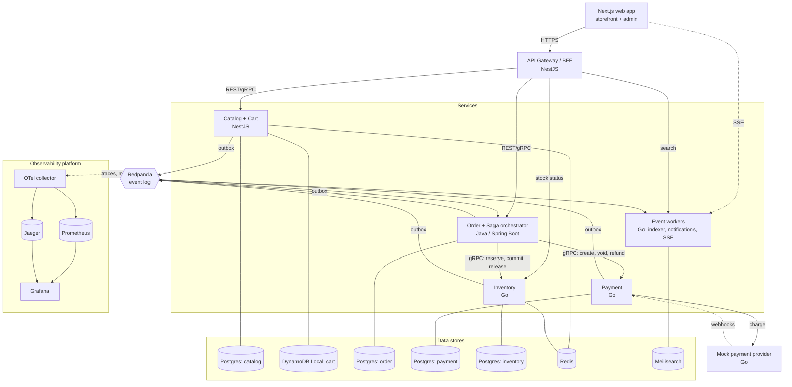
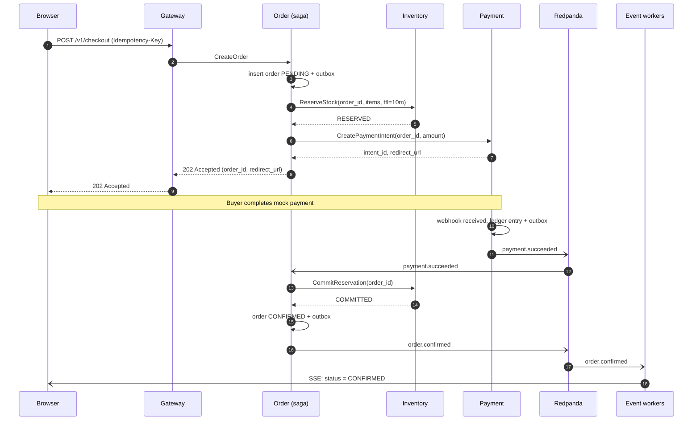
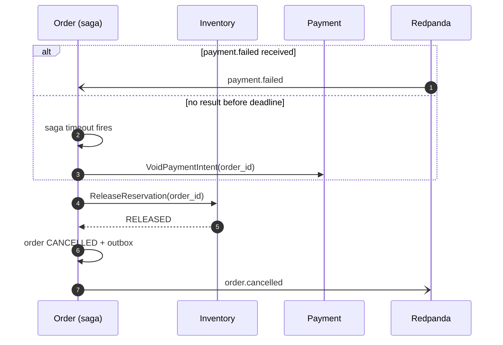
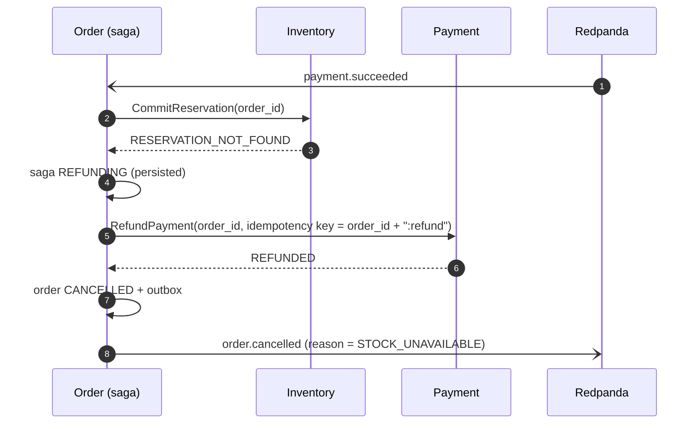

# System Design — Sagamart

| | |
|---|---|
| **Owner** | Rizky |
| **Status** | Draft |
| **Last updated** | 2026-10-21 |
| **Related** | [PRD](../product/prd.md), [Context Map](context-map.md), [ADRs](../adr/README.md) |

## 1. Overview

Sagamart is split into six services along business boundaries. Services own their data, communicate synchronously only where a user is waiting, and otherwise exchange events through a log-based broker. Checkout is a multi-service workflow coordinated by an orchestrated saga in the Order service.

Design priorities, in order:

1. **Correctness** — no oversell, no double charge, no lost order.
2. **Isolation** — a failure in one context degrades only that context.
3. **Observability** — every request and event is traceable.
4. **Throughput** — the hot path (inventory reservation) scales horizontally.

## 2. System context (C4 level 1)

## 3. Containers (C4 level 2)

### Service responsibilities

| Service | Language | Owns | Exposes | Publishes | Consumes |
|---|---|---|---|---|---|
| API Gateway / BFF | NestJS | No business data | Public REST API, auth, rate limits | — | — |
| Catalog + Cart | NestJS | Products, categories, prices, carts | Internal REST/gRPC | `catalog.product.*` | — |
| Order | Java | Orders, saga state | Internal gRPC | `order.*` | `payment.*`, `inventory.reservation.expired` |
| Payment | Go | Payments, ledger entries | Internal gRPC, provider webhooks | `payment.*` | — |
| Inventory | Go | Stock levels, reservations | Internal gRPC | `inventory.*` | — |
| Event workers | Go | Search index, notification log | Search API, SSE endpoint | — | `catalog.*`, `order.*` |
| Mock payment provider | Go | Simulated provider transactions | Charge API; sends webhooks to Payment | — | — |

The mock payment provider stands in for a real payment gateway. It can be told (through a test-only control API) to delay, fail, or deliver the same webhook several times, which the chaos and acceptance tests rely on.

**Internal gRPC commands:** `InventoryService.ReserveStock`, `CommitReservation`, `ReleaseReservation`; `PaymentService.CreatePaymentIntent`, `VoidPaymentIntent`, `RefundPayment`.

## 4. Communication patterns

| Pattern | Used for | Why |
|---|---|---|
| Synchronous REST (public) | Browser → gateway | Standard, cache-friendly, easy to document with OpenAPI |
| Synchronous gRPC (internal) | Saga commands: reserve stock, charge payment | Typed contracts, low latency, deadlines propagate |
| Asynchronous events via outbox | State changes other contexts care about | Decouples services; survives consumer downtime |
| Server-Sent Events | Live order status to the browser | One-way, simple, works through proxies |

Rule of thumb: **commands are synchronous and targeted; facts are asynchronous and broadcast.**

## 5. Key flow: checkout saga

The Order service orchestrates checkout. Each step has a compensating action.

| Step | Action | Compensation |
|---|---|---|
| 1 | Create order in `PENDING` | Mark order `CANCELLED` |
| 2 | Inventory: reserve stock (TTL 10 min) | Inventory: release reservation |
| 3 | Payment: create payment intent (idempotency key = order ID) | Payment: void intent (before capture) or refund (after capture) |
| 4 | Wait for `payment.succeeded` or `payment.failed`, up to the payment deadline (default 8 min, shorter than the 10-min reservation TTL) | — |
| 5 | Inventory: commit reservation | Payment: refund, then mark order `CANCELLED` (see failure path below) |
| 6 | Mark order `CONFIRMED`, publish `order.confirmed` | — |

### Happy path

### Failure path: payment fails or times out

Inventory also expires reservations on its own when the TTL passes and publishes `inventory.reservation.expired`, so stock is released even if the Order service is down. Because the payment deadline (8 min) is shorter than the reservation TTL (10 min), the saga normally cancels before Inventory's expiry has to act.

### Failure path: payment succeeds but the stock commit fails

This is rare but must be handled: for example, a payment confirmation arrives just after the reservation expired, or Inventory rejects the commit.

An automatic refund as saga compensation is in scope. Customer-requested cancellations and refunds after an order is confirmed are not (see PRD non-goals). If the refund itself keeps failing after its retry budget, the saga moves to `NEEDS_ATTENTION` and appears in the admin saga inspector for an operator.

### Order status vs saga state

These are separate on purpose. **Order status** is what the buyer sees; **saga state** is the orchestrator's internal progress.

| Order status (customer-visible) | Saga states that map to it |
|---|---|
| `PENDING` | `STARTED`, `RESERVING_STOCK` |
| `AWAITING_PAYMENT` | `AWAITING_PAYMENT` |
| `PAID` | `COMMITTING_STOCK` |
| `CONFIRMED` | `COMPLETED` |
| `CANCELLED` | `CANCELLING`, `REFUNDING`, `CANCELLED` |
| (unchanged; operator alerted) | `NEEDS_ATTENTION` |

`SHIPPED` and `DELIVERED` are order statuses set by an admin after the saga completes (PRD FR-16); they are not saga states. The full transition table is defined in RFC-0002.

## 6. Data management

- **Database per service.** No service reads another's tables. Cross-context data arrives through events or APIs. See [ADR-0004](../adr/0004-database-per-service.md).
- **Transactional outbox.** A state change and its event are written in the same local transaction; a relay publishes outbox rows to Redpanda. See [ADR-0006](../adr/0006-transactional-outbox.md).
- **Idempotent consumers.** Every consumer records processed event IDs (or uses natural idempotency) so at-least-once delivery is safe.
- **Money** is stored as `BIGINT` IDR with a currency code; never floating point.

| Store | Data | Consistency need |
|---|---|---|
| Postgres (catalog) | Products, categories, prices | Strong within service |
| DynamoDB Local | Carts (TTL 7 days) | Single-key, eventually consistent reads acceptable |
| Postgres (order) | Orders, saga instances, outbox | Strong |
| Postgres (payment) | Payment intents, double-entry ledger, outbox | Strong, append-only ledger |
| Postgres (inventory) | Stock, reservations, outbox | Strong; contention hot spot |
| Redis | Catalog cache, rate-limit counters, optional reservation fast path | Best effort (cache) |
| Meilisearch | Product search index | Eventually consistent (target < 5 s) |

## 7. Cross-cutting concerns

| Concern | Approach |
|---|---|
| Authentication | Staged: until the Core complete release, the gateway issues and verifies a signed development JWT with buyer and admin roles; from then, OIDC (Casdoor or Keycloak) at the gateway. In both cases services trust a signed internal identity header from the gateway |
| Authorisation | Role checks at the gateway (buyer, admin); ownership checks in services |
| Tracing | OpenTelemetry in all services; W3C `traceparent` over HTTP, gRPC and event headers |
| Logging | Structured JSON, shared field names (see [conventions](../engineering/conventions.md)) |
| Metrics | Prometheus; RED metrics per endpoint, lag and DLQ size per consumer |
| Configuration | Environment variables; no secrets in the repo |
| Resilience | Timeouts on every outbound call, retries with jittered backoff, circuit breakers on gateway → service calls |
| Rate limiting | Token bucket at the gateway, per IP and per user |

## 8. Deployment

Until the Optional release, all components run in Docker Compose on one host, with one container per service and per database. The Scale release runs multiple instances of the Go services on the same host. The Optional release adds Kubernetes manifests (k3s) on small VPSes.

## 9. Risks and open questions

| Risk / question | Mitigation or next step |
|---|---|
| Three languages triple the tooling overhead | Shared conventions doc, one Makefile entry point, identical CI stages per language |
| Saga logic grows complex | Explicit state machine with a transition table, test-first; RFC-0002 before the Checkout saga stage |
| Inventory contention under flash sale | Benchmark three strategies during the First slice stage; record the result as an ADR |
| Event schema drift between languages | Contracts in `contracts/`, generated types, contract tests in CI |
| Scope creep | PRD non-goals are binding; new ideas go to the backlog as "future work" (see [development process](../engineering/development-process.md)) |
| Payment confirmed after stock is gone | Automatic refund path in the saga; payment deadline shorter than reservation TTL |
