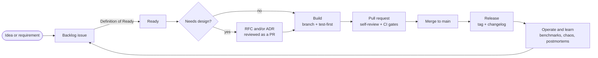

# Development Process — Sagamart

| | |
|---|---|
| **Owner** | Rizky |
| **Status** | Accepted |
| **Last updated** | 2026-10-21 |
| **Related** | [PRD](../product/prd.md), [Conventions](conventions.md), [Testing Strategy](testing-strategy.md) |

Sagamart is built by one engineer, but it is run the way a disciplined team would run it. Every change follows the same path from idea to release, and every step leaves a trace in the repo: an issue, a design note where needed, tests, a reviewed pull request, a changelog entry. That trace is how a reviewer can see the engineering process, not just the code.

## 1. Lifecycle at a glance



## 2. Planning

### Tools

- **GitHub Projects board** with columns: Backlog → Ready → In progress → In review → Done.
- **Milestones = stages:** 0 Foundation, 1 First slice, 2 Checkout saga, 2.5 Showcase, 3 Events, 4 Scale work, 5 Complete, 6 Deploy. Each milestone has the target date from the [PRD release plan](../product/prd.md#9-release-scope-and-timeline).
- **Labels:**
  - Type: `feature`, `bug`, `chore`, `docs`, `spike`
  - Service: `svc:inventory`, `svc:order`, `svc:payment`, `svc:catalog`, `svc:gateway`, `svc:event-workers`, `web`
  - Requirement: `FR-06`, `FR-07`, ... (see [traceability](#9-traceability))
  - Priority: `P1` (blocks the milestone), `P2` (should land), `P3` (nice to have)
  - Size: `S`, `M`, `L`

### Issue types

| Type | Must contain |
|---|---|
| Feature | Linked PRD requirement or stage goal, acceptance criteria, size |
| Bug | Steps to reproduce, expected vs actual, trace ID or logs, severity |
| Chore | What and why (dependency update, refactor, tooling) |
| Spike | The question to answer, a time box (max 4 hours), and the expected output (an ADR, notes, or a follow-up issue). Spike code is thrown away. |

### Sizing

| Size | Effort | Rule |
|---|---|---|
| S | up to 2 hours | One sitting |
| M | up to 6 hours | Two or three sittings |
| L | up to 12 hours | Must be split if it grows beyond this |

Estimates and actuals are compared in the weekly review to calibrate future planning.

### Definition of Ready

An issue can move to Ready when:

- [ ] It links to a PRD requirement, a stage goal, or a bug.
- [ ] Acceptance criteria are written and testable.
- [ ] It is sized S, M or L (anything bigger is split).
- [ ] Dependencies on other issues or contracts are known.
- [ ] It is decided whether an RFC or ADR is needed first (see [section 4](#4-design)).

## 3. Weekly cadence

A one-week cycle fits a solo, part-time project (about 22 hours a week on Sagamart).

| When | Activity | Output |
|---|---|---|
| Monday, 30 min | **Planning:** set one weekly goal; pull Ready issues from the current milestone up to about 20 hours (leave slack) | Issues in "In progress" order; weekly goal written on the board |
| Each session, 5 min | **Check-in:** what's next, any blocker | A one-line comment on the active issue |
| Sunday, 45 min | **Review:** demo the week's work to yourself from a clean `make up`; compare progress against the milestone date | Short weekly note |
| Sunday, same session | **Retro:** keep / stop / try | Note in `docs/retros/YYYY-WW.md` |

**When behind schedule:** if a milestone is more than one week behind, cut scope using the PRD release table (move P2/P3 issues to the next milestone). The MVP date of 13 December 2026 does not move; scope does.

## 4. Design

| Situation | Write | Where |
|---|---|---|
| New service, new cross-service flow, or change touching more than one service | **RFC** before building | `docs/rfc/NNNN-title.md`, reviewed as its own PR |
| A significant decision that is hard to reverse or that a newcomer would question | **ADR** | `docs/adr/NNNN-title.md` |
| A change to an API or event schema | **Contract change** first, then code | `contracts/`, checked for compatibility in CI |
| Everything else | Notes in the issue or PR description | — |

Planned RFCs: RFC-0001 Inventory reservation (before Stage 1), RFC-0002 Checkout saga (before Stage 2), RFC-0003 Events and live tracking (before Stage 3), RFC-0004 Scale work (before Stage 4).

## 5. Build

- **Branch from `main`** using the naming in [conventions](conventions.md#11-git-and-code-review), one branch per issue.
- **Test-first for domain logic** (see [testing strategy](testing-strategy.md#2-test-driven-and-behaviour-driven-development)). Commit the failing test, then the implementation.
- **Small pull requests:** aim for under 400 changed lines, excluding generated code and lockfiles.
- **`main` is always releasable.** Unfinished work is either not wired in yet or switched off by configuration.
- **Database migrations are forward-only and backward-compatible** (expand, migrate, then contract in a later release), so a service can be rolled back without a schema rollback. Tools per language are in [conventions](conventions.md#9-database-migrations).

## 6. Review

Every change goes through a pull request, even working alone.

- **Self-review after a break:** review your own PR in a later session, not right after writing it. Fresh eyes catch more.
- **Use the PR template checklist** (see [appendix A](#appendix-a-pull-request-template)).
- **Get outside eyes on the important ones when available:** if a peer or mentor can review, ask them to look at RFCs and the saga implementation; one or two external reviews are worth more than any checklist. Without one, an RFC can be accepted after the self-review break plus the automated review on the PR (CodeRabbit). Record which kind of review it had in the RFC's decision log.
- **Branch protection on `main`:** pull request required, all required CI checks passing, squash merge for a linear history.

## 7. Quality gates in CI

| Gate | Tools | Runs | Blocks merge |
|---|---|---|---|
| Format and lint | `gofmt` + `golangci-lint`, ESLint + Prettier, Spotless + Checkstyle | Every PR | Yes |
| Unit tests | `go test -race`, JUnit, Vitest/Jest | Every PR | Yes |
| Contract compatibility | `buf breaking`, event schema diff, OpenAPI validation | Every PR touching `contracts/` or a service API | Yes |
| Integration tests | Testcontainers | Every PR | Yes |
| Secret scanning | gitleaks | Every PR | Yes |
| Dependency vulnerabilities | `govulncheck`, `npm audit`, OWASP Dependency-Check | Every PR, and weekly | Yes for high/critical |
| Container image scan | Trivy | On image build | Yes for critical |
| Docs | Markdown lint, link checker | PRs touching `docs/` | Yes |
| Acceptance and E2E | Cucumber, Playwright on Docker Compose | On `main` and before release | Blocks release |
| Dependency updates | Renovate (grouped weekly PRs) | Weekly | — |

## 8. Release

- **Versioning:** semantic versioning per service, tagged `inventory/v0.3.1`. The platform as a whole is tagged at each release: `v0.1.0` MVP, `v0.2.0` Events, `v0.3.0` Scale, `v1.0.0` Core complete.
- **Changelogs:** [Keep a Changelog](https://keepachangelog.com/) format, generated from Conventional Commits (git-cliff or release-please), one per service plus a root `CHANGELOG.md`.
- **GitHub Releases** for each platform tag, with highlights, benchmark results and known issues.

**Release checklist:**

- [ ] All acceptance scenarios and the invariant checker pass.
- [ ] Benchmarks re-run if performance-sensitive code changed; results recorded in `docs/benchmarks/`.
- [ ] `make demo` works from a clean clone in under 10 minutes.
- [ ] Docs, ADR statuses and the PRD release table are current.
- [ ] Changelogs generated and reviewed; tag pushed; GitHub Release published.

## 9. Traceability

Every requirement can be followed from the PRD to the release that shipped it.

| From | To | How |
|---|---|---|
| PRD requirement (`FR-06`) | Issue | Issue carries the `FR-06` label and links the PRD |
| Issue | Pull request | PR description says `Closes #123` |
| Pull request | Tests | Feature scenarios tagged `@FR-06`; test names reference the behaviour |
| Tests | Release | Release notes list the requirements completed |

## 10. Operate and learn

- **Every chaos experiment and real failure gets a blameless postmortem** (see [appendix B](#appendix-b-postmortem-template)) in `docs/operations/postmortems/`. Action items become issues.
- **Every bug fix starts with a failing test** that reproduces it.
- **Runbooks are updated** whenever an alert or recovery procedure changes.

## Definition of Done

This is the single Definition of Done for Sagamart. A change is done when:

- [ ] Its acceptance criteria are met.
- [ ] The [testing checklist](testing-strategy.md#8-testing-checklist) is met (domain logic written test-first, integration tests for new I/O, contracts compatible, concurrency tested).
- [ ] All blocking CI gates pass.
- [ ] Observability is in place: structured logs with trace IDs; metrics for new endpoints or consumers; health and readiness probes for new services.
- [ ] Docs are updated: service README, contracts, and an ADR or RFC status where relevant.
- [ ] The PR was self-reviewed after a break and merged; the issue is closed with a link to the PR.
- [ ] For a new service: Dockerfile, `.env.example`, README and CHANGELOG exist.

---

## Appendix A: Pull request template

Saved as `.github/pull_request_template.md`.

```markdown
## What and why
<!-- One paragraph. Link the issue: Closes #123. Requirement: FR-xx -->

## How it was built
- [ ] Tests written first for domain logic (name them)
- [ ] Design followed RFC/ADR: <link or "n/a">

## How it was verified
<!-- Tests run, manual checks, screenshots, benchmark numbers -->

## Checklist
- [ ] CI green
- [ ] Contracts updated and compatible (or n/a)
- [ ] Logs, metrics and traces for new paths
- [ ] Docs and CHANGELOG updated
- [ ] Self-reviewed in a later session

## Risks and rollback
<!-- What could go wrong, and how to undo it -->
```

## Appendix B: Postmortem template

Saved as `docs/operations/postmortems/0000-template.md`.

```markdown
# Postmortem: <title>

| Date | Severity | Trigger | Duration |
|---|---|---|---|

## Summary
Two or three sentences: what happened and what the impact was.

## Impact
Orders, payments or users affected; invariants violated (if any).

## Timeline
| Time (UTC) | Event |
|---|---|

## Root cause
The underlying cause, not just the trigger.

## What went well / what went badly

## Action items
| Action | Issue | Owner |
|---|---|---|
```

## Appendix C: Weekly review template

Saved as `docs/retros/0000-template.md`.

```markdown
# Week YYYY-WW

**Goal:** <the weekly goal set on Monday>  **Met?** yes / partly / no

| Planned (h) | Actual (h) | Issues done | Milestone on track? |
|---|---|---|---|

## Keep
## Stop
## Try
## Risks or scope changes
```
