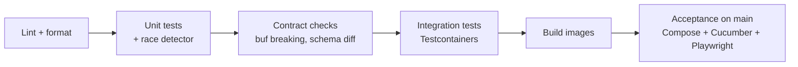

# Testing Strategy — Sagamart

| | |
|---|---|
| **Owner** | Rizky |
| **Status** | Draft |
| **Last updated** | 2026-10-21 |

The goal of testing in Sagamart is confidence in the properties the PRD promises: no oversell, no double charge, no lost order. Tests are layered so that most bugs are caught by fast tests, and the slow tests check only what fast tests can't.

## 1. Test layers

| Layer | What it proves | Scope | Runs | Target share |
|---|---|---|---|---|
| **Unit** | Domain logic is correct | One package/class, no I/O | Every commit, < 30 s per service | ~70% |
| **Integration** | Code works with its real dependencies | One service + real Postgres/Redis/Redpanda via Testcontainers | Every PR | ~20% |
| **Contract** | Services agree on APIs and events | Producer/consumer schemas | Every PR | Per contract |
| **Behaviour (BDD)** | PRD acceptance criteria hold | Gherkin scenarios against the full stack | On `main` and before release | One feature file per critical FR |
| **End to end** | The buyer journey works through the real stack | Full Docker Compose stack + Playwright | On `main` and before release | A handful |
| **Load** | Throughput and latency targets hold | Full stack + k6 | From the MVP, on demand and nightly | Per scenario |
| **Chaos** | Correctness holds under failure | Full stack + fault injection | From the MVP, scripted | Per scenario |

## 2. Test-driven and behaviour-driven development

### 2.1 TDD: where and how

Domain logic is written **test-first**: a failing test (red), the smallest code that passes (green), then cleanup with all tests passing (refactor).

| Write test-first | Don't force TDD |
|---|---|
| Inventory reservation rules and concurrency (Go) | Framework wiring, dependency injection, config |
| Checkout saga state machine (Java) | UI layout and styling |
| Payment idempotency and ledger balancing (Go) | Generated code (protobuf, OpenAPI clients) |
| Pricing and cart rules (NestJS) | Throwaway spikes while learning a library (delete the spike, then rebuild test-first) |
| Rate limiter, reservation-expiry heap, backoff | Glue code already covered by integration tests |

**Outside-in workflow for each feature:**

1. Turn the PRD acceptance criterion into a failing behaviour or integration test.
2. Drive the domain logic with small unit tests, one behaviour at a time.
3. Connect the pieces (database, broker) until the outer test passes.
4. Refactor with everything green.

**Design rule that makes TDD easy:** keep domain logic pure and push I/O to the edges. The saga, for example, is a function `(state, event) → (new state, commands)`; repositories, gRPC clients and the outbox sit around it. One unit test per row of the saga's transition table, including duplicate, late and out-of-order events.

**Concurrency is test-first too.** Example: with 100 units in stock, 1,000 concurrent reservations of 1 unit must produce exactly 100 successes, run with `-race` against a real Postgres. A naive read-then-write implementation fails this test, which is what drives the atomic conditional update.

### 2.2 BDD: executable acceptance criteria

The PRD's acceptance criteria for the critical requirements are written as Gherkin scenarios and executed with Cucumber (JVM) against the Docker Compose stack.

```gherkin
Feature: Automatic rollback on failed payment (FR-08)

  Scenario: Payment fails after stock is reserved
    Given product "KAOS-001" has 10 units in stock
    And a customer checks out 2 units of "KAOS-001"
    When the payment fails
    Then the order status becomes "CANCELLED"
    And "KAOS-001" has 10 units available again
```

| Feature file | PRD requirement | Release |
|---|---|---|
| `stock-reservation.feature` | FR-06 | MVP |
| `idempotent-payments.feature` | FR-07 | MVP |
| `automatic-rollback.feature` | FR-08 | MVP |
| `flash-sale.feature` | J6 | MVP |
| `live-order-status.feature` | FR-09 | Events |

Feature files live in `tests/acceptance/features/`; step definitions call the public API and read state through admin endpoints, never through service databases.

### 2.3 Making it visible

- Commit the failing test before the implementation: `test(inventory): reject reservation above available stock`, then `feat(inventory): implement reservation`.
- PR descriptions name the tests written first and the design they led to.
- Each service README links to its feature files and key test suites.

## 3. What to test where

### Unit tests

- Pure domain logic: price calculation, order state machine transitions, reservation expiry ordering, ledger balancing, rate limiter.
- Table-driven in Go; parameterised tests in Java (JUnit 5) and Jest/Vitest in TypeScript.
- Concurrency-sensitive Go code is run with `go test -race` always.
- Property-based tests for invariants where it pays off (e.g. "available never goes below zero" for any sequence of reserve/release/commit), using `rapid` (Go) or jqwik (Java).

### Integration tests

- Repository code against a real Postgres (Testcontainers), never mocks of the database.
- Outbox relay: a state change produces exactly one event on a real Redpanda.
- Consumers: duplicate delivery of the same event changes state once.
- Each test owns its data (unique IDs) so tests can run in parallel.

### Contract tests

- REST: OpenAPI specs in `contracts/openapi/` are the source of truth; servers are validated against them in CI and clients are generated from them.
- gRPC: generated from `contracts/proto/`; `buf breaking` blocks incompatible changes.
- Events: each event has a schema in `contracts/events/`. Producers have a test that validates emitted events against the schema; consumers have a test that parses the example payloads. A CI check rejects non-additive schema changes within a version.

### End-to-end tests (Playwright)

Kept deliberately few, one per critical journey:

1. Browse → search → add to cart → checkout → mock pay → see `CONFIRMED` live.
2. Checkout → payment fails → order `CANCELLED`, stock restored.
3. Admin edits product → change appears in search.

### Load tests (k6)

| Scenario | Shape | Pass criteria |
|---|---|---|
| Browse | 500 VUs, read-heavy mix | p99 < 200 ms, error rate < 0.1% |
| Checkout | 50 checkouts/s sustained for 10 min | p99 accept < 500 ms, 0 lost orders |
| Flash sale | 5,000 VUs racing for 100 units | Exactly 100 sold, 0 oversell, fast "sold out" for the rest |

Results go to `docs/benchmarks/` with hardware, versions, methodology and raw numbers.

### Chaos tests

| Experiment | Injected fault | Invariant checked |
|---|---|---|
| C1 | Kill Order service mid-checkout | Every order reaches a terminal state; no stock leaked |
| C2 | Duplicate payment webhook delivery ×3 | Exactly one ledger charge per order |
| C3 | 300 ms latency on Inventory DB | Backpressure holds; no oversell; SLO burn visible |
| C4 | Pause Redpanda for 30 s | No events lost; consumers catch up; lag alert fires |
| C5 | Kill event workers | Search and notifications catch up after restart |
| C6 | Stop the Order and Payment services | Browsing and product pages keep working (PRD availability target); checkout fails fast with a clear error |

Each experiment gets a script in `deploy/chaos/` and a postmortem in `docs/operations/postmortems/`.

## 4. Invariant checker

A small tool (Go, `tools/invariants`) queries every service's database after load and chaos runs and asserts:

- For each SKU: `initial_stock − committed_sales − active_reservations == available`
- For each order: exactly one terminal state, and payment state agrees with order state
- Ledger: total debits equal total credits; at most one capture per order

The checker is what turns "it seemed fine" into evidence.

It is the one deliberate exception to the database-per-service rule: it uses read-only credentials and runs only in test environments, never as part of a service.

## 5. Test data

- Seed script per service creates a deterministic dataset (`make seed`).
- Factories/builders in test code instead of shared fixtures.
- No production-like personal data; generated names and addresses only.

## 6. CI pipeline



- Only changed services run their pipeline (path filters), except contracts, which trigger every consumer.
- A PR is mergeable when lint, unit, contract and integration stages pass.

## 7. Coverage policy

Coverage is a signal, not a target. Domain packages (`state machine`, `reservation`, `ledger`, `pricing`) aim for ≥ 80% line coverage; adapters and wiring are covered by integration tests instead.

## 8. Testing checklist

This checklist is part of the single [Definition of Done](development-process.md#definition-of-done). A change meets it when:

- [ ] New domain logic was written test-first, with failure cases covered.
- [ ] New I/O paths have an integration test.
- [ ] Contract changes pass the compatibility checks.
- [ ] Concurrency code passes `-race` (Go) or has a concurrent test (Java/TS).
- [ ] Any bug fix includes a test that failed before the fix.
- [ ] Changes to a critical PRD flow update its feature file, and the scenarios pass.
