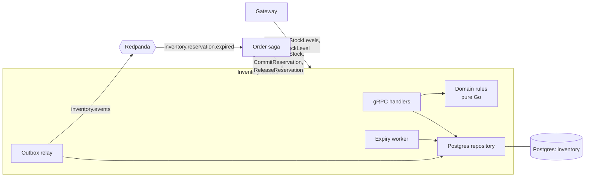

# RFC-0001: Inventory reservation

| | |
|---|---|
| **Author** | Rizky |
| **Status** | Accepted |
| **Created** | 2026-10-21 |
| **Stage** | 1 First slice |
| **Related** | PRD [FR-03, FR-06, FR-11, J6](../product/prd.md), [System Design §5](../architecture/system-design.md#5-key-flow-checkout-saga), [ADR-0004](../adr/0004-database-per-service.md), [ADR-0005](../adr/0005-orchestrated-checkout-saga.md), [ADR-0006](../adr/0006-transactional-outbox.md) |

## 1. Summary

Build the Inventory service (Go): stock levels per SKU, all-or-nothing reservations with a TTL, commit and release, and an expiry worker that releases stock on its own when the Order service is absent. It is the hot path of the flash sale and the place where "never oversell" is enforced, so it is built and benchmarked first.

## 2. Motivation

PRD FR-06 and journey J6 require that available stock never goes below zero under any number of concurrent buyers, and that an expired reservation is released within 30 seconds even if the Order service is down. Every later stage (checkout saga, flash-sale benchmark, chaos tests) depends on these guarantees. If they are wrong, the whole correctness story of the project is wrong.

## 3. Goals and non-goals

**Goals**

- Reserve, commit and release stock with the guarantees in FR-06, for any interleaving of concurrent calls.
- Idempotent commands keyed by `order_id`, so the saga can retry any call safely.
- Expiry without the orchestrator: TTL-based release and an `inventory.reservation.expired` event.
- Admin stock changes (FR-11) and stock levels for product pages (FR-03).
- Benchmark three contention strategies and record the winner as ADR-0008.

**Non-goals**

- Multiple warehouses or locations: one stock pool per SKU.
- Backorders or pre-orders: a reservation either fits available stock or fails.
- Hot-SKU sharding and multi-instance expiry with leader election: Scale release (RFC-0004).
- Catalog data (names, prices): Inventory only knows SKU codes.

## 4. Proposed design

### 4.1 Overview



Postgres is the single source of truth. Every stock change happens inside one local transaction that also writes any resulting event to the outbox. Correctness under concurrency comes from **atomic conditional updates guarded by a database check constraint**, not from application-level locks.

Layout follows the Go conventions: `cmd/inventory`, `internal/domain` (pure rules, no I/O), `internal/store` (Postgres), `internal/grpcapi`, `internal/expiry`, `internal/outbox`.

### 4.2 API and contract changes

Changes to the draft `sagamart.inventory.v1.InventoryService` ([contract](../../contracts/proto/sagamart/inventory/v1/inventory.proto), added in PR #1). The contract becomes **Accepted** with this RFC, after which `buf breaking` applies.

| RPC | Change | Semantics |
|---|---|---|
| `ReserveStock` | Unchanged | All lines or none. Repeat with the same `order_id` returns the original reservation. A repeat with *different* lines returns `ALREADY_EXISTS`. |
| `CommitReservation` | Unchanged | `ACTIVE` → `COMMITTED`. Repeat returns the original `committed_at`. `RESERVATION_NOT_FOUND` if expired, released or unknown. |
| `ReleaseReservation` | Unchanged | `ACTIVE` → `RELEASED`. Releasing a released or expired reservation succeeds. Releasing a committed one fails with `FAILED_PRECONDITION` (`RESERVATION_COMMITTED`). |
| `GetStockLevels` | Unchanged | Read-only, up to 100 SKUs per call. |
| `SetStockLevel` | **New** | Admin sets `on_hand` for a SKU with optimistic concurrency (`expected_version`). Fails with `FAILED_PRECONDITION` if `on_hand` would drop below `reserved`. Creates the SKU row if absent. |

Error details carry a domain `code` (`INSUFFICIENT_STOCK`, `RESERVATION_NOT_FOUND`, `RESERVATION_COMMITTED`, `VERSION_CONFLICT`) in a `google.rpc.ErrorInfo`, so callers never parse messages. `INSUFFICIENT_STOCK` lists each failing SKU with its available quantity, which the gateway turns into the Problem Details `detail`.

Validation: 1–50 lines per reservation, unique SKUs, quantity 1–100 per line (configurable as `INVENTORY_MAX_LINE_QUANTITY`; a sanity limit, not a purchase policy), TTL between 1 and 30 minutes (default 10).

**Events** (topic `inventory.events`, key = `subject`):

| Event | Subject | Data | Consumers |
|---|---|---|---|
| `inventory.reservation.expired/v1` | `order_id` | `orderId`, `reservationId`, `lines[]`, `expiredAt` | Order saga |
| `inventory.stock.adjusted/v1` | `sku` | `sku`, `onHand`, `available`, `version` | Event workers (later: live stock on product pages) |

Committed and released reservations don't emit events: the saga already knows (it made the call), and nobody else needs them yet. Adding them later is an additive change.

### 4.3 Data model

Migrations in `services/inventory/migrations/` (golang-migrate).

```sql
CREATE TABLE stock_levels (
    sku         TEXT PRIMARY KEY,
    on_hand     BIGINT NOT NULL,
    reserved    BIGINT NOT NULL DEFAULT 0,
    version     BIGINT NOT NULL DEFAULT 1,
    updated_at  TIMESTAMPTZ NOT NULL DEFAULT now(),
    CONSTRAINT stock_never_oversold CHECK (reserved >= 0 AND on_hand >= reserved)
);

CREATE TABLE reservations (
    id            UUID PRIMARY KEY,               -- UUIDv7
    order_id      UUID NOT NULL UNIQUE,           -- idempotency key
    status        TEXT NOT NULL CHECK (status IN ('ACTIVE','COMMITTED','RELEASED','EXPIRED')),
    expires_at    TIMESTAMPTZ NOT NULL,
    created_at    TIMESTAMPTZ NOT NULL DEFAULT now(),
    finalized_at  TIMESTAMPTZ
);
CREATE INDEX reservations_active_expiry ON reservations (expires_at) WHERE status = 'ACTIVE';

CREATE TABLE reservation_lines (
    reservation_id UUID NOT NULL REFERENCES reservations (id),
    sku            TEXT NOT NULL REFERENCES stock_levels (sku),
    quantity       BIGINT NOT NULL CHECK (quantity > 0),
    PRIMARY KEY (reservation_id, sku)
);

-- Outbox as in ADR-0006.
CREATE TABLE outbox (
    id             UUID PRIMARY KEY,
    aggregate_type TEXT NOT NULL,
    aggregate_id   TEXT NOT NULL,
    event_type     TEXT NOT NULL,
    payload        JSONB NOT NULL,
    headers        JSONB NOT NULL DEFAULT '{}',
    created_at     TIMESTAMPTZ NOT NULL DEFAULT now(),
    published_at   TIMESTAMPTZ
);
CREATE INDEX outbox_unpublished ON outbox (created_at) WHERE published_at IS NULL;
```

`available = on_hand − reserved` is computed, never stored. On commit, both `on_hand` and `reserved` drop by the line quantity, so `on_hand` always means "physically in the warehouse and not yet sold". The `stock_never_oversold` constraint is the last line of defence: even a bug in the application cannot persist an oversell.

### 4.4 Key flows

**Reserve** (one transaction, `READ COMMITTED`):

1. `INSERT INTO reservations ... ON CONFLICT (order_id) DO NOTHING RETURNING id`. No row returned → this is a retry: load the existing reservation, compare lines, and return it (or `ALREADY_EXISTS`).
2. For each line, **in ascending SKU order** (consistent lock order, so two multi-line reservations can't deadlock):
   `UPDATE stock_levels SET reserved = reserved + $qty, version = version + 1, updated_at = now() WHERE sku = $sku AND on_hand - reserved >= $qty`
3. Any update affecting 0 rows → roll back the whole transaction and return `INSUFFICIENT_STOCK` (a follow-up read collects available quantities for the error detail).
4. Insert `reservation_lines`, commit.

The conditional `UPDATE` is atomic per row: Postgres re-evaluates the `WHERE` against the latest committed row after waiting for a concurrent writer, so two requests can never both pass a check that only one fits.

```mermaid
sequenceDiagram
    autonumber
    participant O as Order saga
    participant I as Inventory
    participant DB as Postgres
    O->>I: ReserveStock(order_id, lines, ttl)
    I->>DB: BEGIN; insert reservation (on conflict do nothing)
    loop each line, sorted by SKU
        I->>DB: conditional UPDATE stock_levels
        DB-->>I: 1 row (or 0 → ROLLBACK, INSUFFICIENT_STOCK)
    end
    I->>DB: insert lines; COMMIT
    I-->>O: reservation_id, expires_at
```

**Commit:** lock the reservation (`SELECT ... FOR UPDATE` by `order_id`). If `COMMITTED`, return the stored result. If `ACTIVE` and `expires_at > now()`: decrement `on_hand` and `reserved` for each line, set `COMMITTED`. Otherwise `RESERVATION_NOT_FOUND`. A reservation past `expires_at` is treated as expired even if the worker hasn't processed it yet, so the expiry time means the same thing to every caller.

**Release:** lock the reservation. If `ACTIVE`: decrement `reserved` for each line, set `RELEASED`. If already `RELEASED` or `EXPIRED`: succeed without changes. If `COMMITTED`: `RESERVATION_COMMITTED`.

**Expiry worker:** every 5 s (configurable), in a loop until a batch comes back empty:

```sql
SELECT id FROM reservations
WHERE status = 'ACTIVE' AND expires_at <= now()
ORDER BY expires_at
LIMIT 100
FOR UPDATE SKIP LOCKED;
```

For each row, in the same transaction: release its stock, set `EXPIRED`, write `inventory.reservation.expired` to the outbox. `SKIP LOCKED` lets the worker run alongside commit and release calls (and later, alongside other instances) without blocking. The 5 s interval plus batch time keeps worst-case release well inside the 30 s target in FR-06.

**Admin stock change:** `UPDATE stock_levels SET on_hand = $new, version = version + 1 WHERE sku = $sku AND version = $expected` (or `INSERT` for a new SKU), plus `inventory.stock.adjusted` in the outbox. 0 rows → `VERSION_CONFLICT`; constraint violation → `FAILED_PRECONDITION`.

### 4.5 Failure modes

| Failure | Detection | Behaviour | Recovery |
|---|---|---|---|
| Order service dies after reserving | Reservation stays `ACTIVE` | Expiry worker releases at TTL and publishes `inventory.reservation.expired` | Order saga consumes the event on restart and cancels the order |
| Saga retries `ReserveStock` after a timeout whose first attempt actually succeeded | `order_id` unique conflict | Original reservation returned | None needed |
| Commit arrives after expiry | `expires_at <= now()` or status `EXPIRED` | `RESERVATION_NOT_FOUND` | Saga refunds and cancels (System Design §5) |
| Inventory DB slow or down | gRPC deadline exceeded / `UNAVAILABLE` | No partial state: each command is one transaction | Saga retries with backoff; `/readyz` fails so traffic drains |
| Inventory down while buyers browse | Gateway's `GetStockLevels` call times out (150 ms) | Product pages still render, with stock shown as "unknown" | None needed; pages show live stock again once Inventory is back |
| Redpanda down | Outbox rows stay unpublished | Commands keep working; events are delayed, not lost | Relay catches up when Redpanda returns |
| Inventory crashes mid-transaction | — | Postgres rolls back | Caller retries (idempotent) |
| Application bug would oversell | `stock_never_oversold` constraint violation | Transaction fails, error logged and counted | Alert on `constraint_violations_total > 0`; fix forward |

### 4.6 Concurrency and consistency

- **Races between reservations for the same SKU** are serialised by the row lock taken by the conditional `UPDATE`; the `WHERE` clause is re-checked after the wait.
- **Deadlocks across multi-line reservations** are prevented by updating rows in SKU order. Any remaining deadlock (`40P01`) or serialisation error is retried up to 3 times inside the service.
- **Reserve vs expiry vs commit vs release on one reservation** are serialised by the reservation row lock (`FOR UPDATE`, and `SKIP LOCKED` on the worker side), and every transition starts by checking the current status, so each reservation has exactly one final status.
- **Idempotency** comes from `order_id` uniqueness and status checks; no separate idempotency table is needed.
- **Hot SKU contention** is the known limit: all buyers of one SKU queue on one row. That is what the benchmark in section 7 measures, and what RFC-0004 addresses if the target isn't met.

## 5. Alternatives considered

These are the three strategies to benchmark; the result becomes ADR-0008.

| Strategy | How it works | Pros | Cons |
|---|---|---|---|
| **A. Conditional UPDATE** (proposed default) | Single atomic `UPDATE ... WHERE available >= qty` | One round trip per line; simplest code; constraint-backed | One hot row per SKU |
| **B. Pessimistic lock** | `SELECT ... FOR UPDATE`, check in Go, then `UPDATE` | Check logic lives in Go, easy to extend | Two round trips while holding the lock, so lower throughput on hot SKUs |
| **C. Redis Lua fast path** | Lua script atomically decrements a Redis counter; Postgres written afterwards | Highest throughput; rejects "sold out" without touching Postgres | Two sources of truth; needs reconciliation and careful crash handling; Redis durability |

Also rejected:

- **Optimistic version check with retry loop:** under a flash sale almost every attempt conflicts, so retries amplify load.
- **`SERIALIZABLE` isolation:** correct but aborts heavily under contention; the conditional update gives the same guarantee for this access pattern at `READ COMMITTED`.
- **In-memory reservation with a heap only:** loses state on crash; violates "released even if Order is down" after an Inventory restart.

## 6. Observability

Metrics (`sagamart_inventory_*`):

| Metric | Type | Labels |
|---|---|---|
| `reservations_total` | counter | `result` = `reserved` / `insufficient_stock` / `duplicate` / `error` |
| `reservation_duration_seconds` | histogram | `result` |
| `reservation_transitions_total` | counter | `to` = `committed` / `released` / `expired` |
| `active_reservations` | gauge | — |
| `expiry_lag_seconds` | histogram | time between `expires_at` and actual expiry |
| `outbox_pending` | gauge | — |
| `constraint_violations_total` | counter | `constraint` (should always be 0) |

Logs carry `order_id`, `reservation_id` and `sku` as fields. Each gRPC call is a span, with child spans for the database transaction. Grafana dashboard "Inventory" with reservation rate and outcome, p50/p99 latency, expiry lag and outbox backlog. Alerts: any constraint violation; expiry lag p99 > 30 s; outbox pending > 1,000 for 1 minute.

## 7. Performance and capacity

Target from the PRD: ≥ 2,000 reservation attempts/s on one laptop-class host, with exactly 100 of 100 units sold in the flash-sale scenario and fast rejection for the rest.

Benchmark plan (results in `docs/benchmarks/`, decision in ADR-0008):

1. **Hot SKU:** 5,000 virtual users racing for 100 units of one SKU.
2. **Spread:** 2,000 reservations/s across 1,000 SKUs with 2–3 lines each.
3. Same hardware, Postgres settings and pool size for each strategy; report p50/p99 latency, throughput, error rate, and the invariant checker result.

A cheap optimisation that applies to every strategy: once a SKU hits zero available, rejections can be answered from a short-lived in-process "sold out" cache (refreshed on release or expiry) without touching Postgres. This is measured separately so it doesn't hide the strategy differences.

## 8. Security and privacy

Inventory is internal only (not exposed by the gateway directly). `SetStockLevel` is called only by the gateway on behalf of an admin; the gateway enforces the role, and Inventory verifies the signed internal identity header and checks for the admin role. No personal data is stored.

## 9. Testing plan

Test-first, per the [testing strategy](../engineering/testing-strategy.md):

- **Unit (pure domain):** line validation, status transition table (every from/to pair, including the idempotent and invalid ones), expiry decisions.
- **Property-based (`rapid`):** for any sequence of reserve/commit/release/expire/set-stock operations, `reserved >= 0`, `available >= 0`, and `on_hand + committed == initial + adjustments`.
- **Concurrency (real Postgres, `-race`):** 100 units, 1,000 concurrent 1-unit reservations → exactly 100 successes and `available == 0`. Variant with multi-line reservations in random SKU orders → no deadlocks.
- **Integration (Testcontainers):** each RPC's idempotency (10 retries → one effect); commit after expiry; release twice; expiry worker releases within the interval and writes exactly one outbox row; relay publishes it to Redpanda.
- **Contract:** expired-event payloads validate against `contracts/events/schemas/inventory.reservation.expired.v1.schema.json`.
- **Acceptance:** `stock-reservation.feature` (FR-06) and the inventory part of `flash-sale.feature` (J6).

## 10. Rollout plan

1. Merge this RFC; update the proto (`SetStockLevel`, error codes, mark Accepted) and add the two event schemas in one contract PR.
2. Inventory service skeleton: config, logging, tracing, health probes, migrations, Dockerfile, Compose entry.
3. Domain rules and the transition table, test-first.
4. Postgres store with the concurrency test, then the gRPC API.
5. Expiry worker and outbox relay.
6. Benchmark strategies A, B and C on a throwaway branch; write ADR-0008; keep only the winner in `main`.

Nothing calls Inventory until Stage 2, so each step merges independently without feature flags.

## 11. Open questions

- [x] Should a commit that arrives after `expires_at`, but before the worker runs, be honoured? **No: strict expiry.** See the decision log.
- [x] Is a per-line cap of 100 right, or should there be a per-buyer limit? **Keep the configurable per-line cap; per-buyer limits are out of Inventory and out of the MVP.**
- [x] Should `GetStockLevels` be cached at the gateway? **Not in the MVP; stock is optional on product pages instead.**

## 12. Decision log

| Date | Decision | Notes |
|---|---|---|
| 2026-10-21 | Draft opened | |
| 2026-10-21 | Strict expiry: a commit at or after `expires_at` returns `RESERVATION_NOT_FOUND` | The payment deadline (8 min) is shorter than the TTL (10 min), so late commits are rare, and the saga's refund path handles them. One timestamp, compared against Postgres `now()`, decides; the worker and commit never both judge liveness, and clock skew between services can't matter. |
| 2026-10-21 | Per-line cap 1–100, configurable; no per-buyer limit in Inventory | The cap is input validation. A per-buyer limit is business policy that needs buyer identity and history, so it belongs in Order or the gateway, configured per product in Catalog. Added to the backlog as a "Could"; J6 doesn't need it. |
| 2026-10-21 | No stock-level cache in the MVP; gateway treats stock as optional with a 150 ms timeout | `GetStockLevels` is a primary-key read and Postgres reads don't wait on reservation row locks, so browsing doesn't contend with the flash sale. A cache would weaken FR-03's "live" stock. If the browse load test (p99 < 200 ms) shows a need, add a 1 s gateway cache with an ADR. |
| 2026-10-21 | Accepted | Self-review plus automated PR review (CodeRabbit); no outside reviewer available. |
