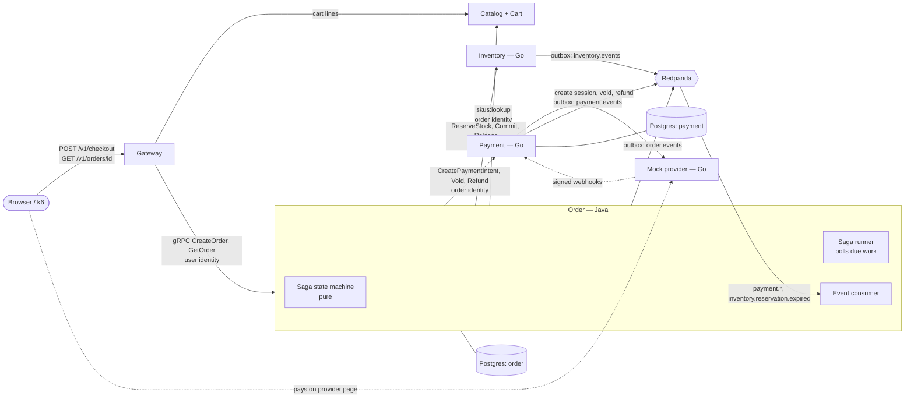
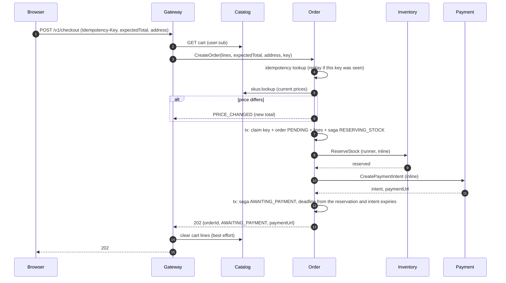

# RFC-0002: Checkout saga, Order and Payment

| | |
|---|---|
| **Author** | Rizky |
| **Status** | Accepted |
| **Created** | 2026-10-23 |
| **Stage** | 2 Checkout saga |
| **Related** | PRD [FR-06, FR-07, FR-08, FR-12, J3, J5](../product/prd.md); [System Design §5](../architecture/system-design.md#5-key-flow-checkout-saga); [Context Map](../architecture/context-map.md); [ADR-0004](../adr/0004-database-per-service.md), [ADR-0005](../adr/0005-orchestrated-checkout-saga.md), [ADR-0006](../adr/0006-transactional-outbox.md); [RFC-0001](0001-inventory-reservation.md), [RFC-0005](0005-catalog-cart-gateway.md); [identity contract](../../contracts/identity.md) |

## 1. Summary

Build checkout: a buyer turns their cart into an order, pays through a mock payment provider, and the order is confirmed; or, if anything fails, the stock is released, any money is returned and the order is cancelled. This adds three services:

- **Order** (Java / Spring Boot), which runs the checkout saga as a persisted state machine.
- **Payment** (Go), which takes money exactly once through an idempotent API, a double-entry ledger and verified provider webhooks.
- **Mock payment provider** (Go), which can be told to fail, stall or repeat itself.

ADR-0005 chose orchestration; this RFC defines what it left open:

- the states and transitions;
- timeouts and retry budgets;
- idempotency keys per step;
- crash recovery;
- the service identity Order uses.

## 2. Motivation

The MVP's correctness claims live here:

- **FR-07:** payment retries never double-charge.
- **FR-08:** failed or timed-out checkouts release stock and cancel the order, even if a service is killed mid-checkout.
- **FR-12:** an admin can see each order's saga steps.

FR-06 (reservation) is done in Inventory, but nothing calls it for real yet. The showcase stage (J6 flash sale end to end, the invariant checker, chaos C1 and C2) needs all of this. Without it, Sagamart is a catalog with carts.

## 3. Goals and non-goals

**Goals**

- `POST /v1/checkout` turns the signed-in buyer's cart into an order at the current prices, reserves stock, and returns where to pay.
- Every checkout ends in exactly one terminal state, `CONFIRMED` or `CANCELLED`, with stock and money consistent. The narrow exception is `NEEDS_ATTENTION`, when a compensation keeps failing; it is visible to an admin.
- No double charge: retries, duplicate webhooks and a crashed orchestrator all charge at most once (FR-07's acceptance criteria).
- The saga survives an Order restart at any point and resumes from its stored state.
- An admin can list orders and see every saga step with timestamps, attempts and errors (FR-12).
- Order and Payment publish their facts through the outbox (ADR-0006) for the Events stage to consume.

**Non-goals**

- **Guest checkout.** An order belongs to a signed-in buyer (its `sub`). Guests sign in first; cart merge (FR-05) is Core complete.
- **Partial fulfilment.** All lines or nothing, as Inventory already guarantees.
- **Customer cancellations and refunds after confirmation** (PRD non-goal). Automatic refunds as compensation are in scope.
- **Live status over SSE** (FR-09, Events stage): buyers poll `GET /v1/orders/{id}` for now.
- **Shipping states** (FR-16, Core complete), taxes, shipping fees, discounts and multiple currencies.
- **A real payment gateway.** The provider adapter is the anti-corruption layer (context map), so one could replace the mock later.

## 4. Proposed design

### 4.1 Overview



- **The state machine is a pure function**, `(SagaState, SagaEvent) → (SagaState, List<Command>)`, with no I/O, so every row of the transition table is a unit test (testing strategy §2).
- **The runner turns commands into calls.** A command is persisted with the new state, then executed by a background runner. Its result comes back as an event. Nothing is "in flight" only in memory, so a restart resumes where it stopped.
- **Commands are synchronous gRPC with deadlines; outcomes that come later are events** (system design §4). That covers the payment result and a reservation that expired on its own.
- **Order is the only caller of the saga RPCs.** It identifies itself with its own signed service identity (§8), so Inventory and Payment accept those RPCs from Order and nobody else.

### 4.2 API and contract changes

All contracts land in `contracts/` before code (step 1 of the rollout).

**Public API** (`public-v1.yaml`, served by the gateway):

| Method and path | Who | Purpose |
|---|---|---|
| `POST /v1/checkout` | buyer | Body: `{ "expectedTotal": Money, "shippingAddress": {...}, "paymentMethod": "MOCK_CARD" }`. **`Idempotency-Key` required** (enforced by Order, as Catalog does for admin writes). Returns `202` with `{ orderId, status, total, paymentUrl? }`, or one of the refusals below. |
| `GET /v1/orders/{orderId}` | buyer (own) or admin | The order: lines at their locked prices, total, status, `paymentUrl` while awaiting payment, `cancelReason`, timestamps |
| `GET /v1/admin/orders?status=&cursor=&limit=` | admin | Orders newest first, keyset-paginated |
| `GET /v1/admin/orders/{orderId}/saga` | admin | FR-12: saga state, deadline, and every step (event or command) with time, attempt, outcome and error |

`POST /v1/checkout` refuses with:

| Status | Code | When |
|---|---|---|
| `422` | `CART_EMPTY` | Nothing to check out |
| `422` | `ITEM_UNAVAILABLE` | A SKU is no longer for sale |
| `409` | `PRICE_CHANGED` | The current total differs from `expectedTotal`; carries the new total, so the buyer never pays an amount they didn't see |
| `409` | `INSUFFICIENT_STOCK` | Carries the shortfalls; the order is recorded `CANCELLED` so it still shows in FR-12 |

**Checkout from the cart.** The gateway reads the buyer's cart from Catalog and sends its lines (SKU and quantity, no prices) to Order, **even when the cart is empty**. Order decides `CART_EMPTY`, after the idempotency check. Order re-reads the authoritative prices with Catalog's `skus:lookup` (context map: the cart's price is a snapshot). The gateway clears the cart's lines after a `202`, best effort: a failed clear leaves lines the buyer can remove. A cancelled order doesn't restore them.

**Idempotency comes first.** A lost `202` followed by a retry finds the cart already cleared, so `CreateOrder` must recognise the retry before looking at lines or prices:

1. It looks up `(buyer, Idempotency-Key)`. A stored response is replayed: the original `orderId` and its current status.
2. Otherwise it validates the lines (`CART_EMPTY`), re-reads prices (`ITEM_UNAVAILABLE`, `PRICE_CHANGED`), then claims the key in the same transaction that inserts the order.
3. A concurrent duplicate that loses the claim waits on the key's row and replays the winner's response, as in Catalog (RFC-0005 §4.4).

The request hash covers what the client sent (`expectedTotal`, `shippingAddress`, `paymentMethod`), not the cart lines. So a retry with an emptied cart is still "the same request", and a different body under the same key is `422 IDEMPOTENCY_KEY_REUSED`.

**Internal gRPC** (`contracts/proto`):

- **`sagamart.order.v1.OrderService`** (new): `CreateOrder`, `GetOrder`, `ListOrders`, `GetSaga`. Called by the gateway with the user's identity (`aud: "order"`).
- **`sagamart.payment.v1.PaymentService`:** the draft is finalised.
  - `CreatePaymentIntent` is idempotent on `idempotency_key` = order ID. A repeat with a different amount is `ALREADY_EXISTS` (`INTENT_CONFLICT`).
  - `VoidPaymentIntent` asks the provider first (§4.4). If the payment was in fact captured, it records the capture and answers `FAILED_PRECONDITION` (`ALREADY_CAPTURED`), and the saga refunds instead.
  - `RefundPayment` is idempotent on `order_id + ":refund"`.
  - `GetPayment` is added for the saga's own reconciliation and FR-12.
  - Errors carry `google.rpc.ErrorInfo` with domain `payment.sagamart.dev`, as Inventory's do.
- **`InventoryService`:** unchanged. The saga RPCs start requiring the `order` service identity (§8).

**Events** (`contracts/events`, topic per context, partitioned by order ID):

| Type | Topic | Published when | Consumed by |
|---|---|---|---|
| `payment.succeeded/v1` | `payment.events` | A capture is recorded (webhook or reconciliation) | Order |
| `payment.failed/v1` | `payment.events` | The provider declined or the intent expired | Order |
| `payment.refunded/v1` | `payment.events` | A refund is recorded | Order (history), Events stage |
| `order.confirmed/v1` | `order.events` | Saga `COMPLETED` | Events stage (FR-09, FR-14) |
| `order.cancelled/v1` | `order.events` | Saga `CANCELLED`, with `reason` | Events stage |
| `inventory.reservation.expired/v1` | `inventory.events` | Exists (RFC-0001) | Order |

`order.created` and per-step events are deliberately left out. The saga's history lives in Order's database for FR-12, and nobody consumes per-step events yet; adding one later is backward compatible.

**Identity contract:** a minor version adds **service identities** (§8).

**Provider webhook:** documented in `contracts/payment-provider.md`. The mock provider and Payment's adapter both implement it, so the anti-corruption layer has a written edge.

### 4.3 Data model

**Order — Postgres** (`order-db`), Flyway migrations:

```sql
CREATE TABLE orders (
    id               UUID PRIMARY KEY,                -- UUIDv7, also every downstream idempotency key's root
    buyer_id         UUID NOT NULL,                   -- the identity's sub
    status           TEXT NOT NULL,                   -- PENDING, AWAITING_PAYMENT, PAID, CONFIRMED, CANCELLED
    cancel_reason    TEXT,                            -- INSUFFICIENT_STOCK, PAYMENT_FAILED, PAYMENT_TIMEOUT, STOCK_UNAVAILABLE, ...
    total_amount     BIGINT NOT NULL CHECK (total_amount > 0),
    currency         CHAR(3) NOT NULL DEFAULT 'IDR',
    shipping_address JSONB NOT NULL,                  -- personal data (§8)
    payment_url      TEXT,
    version          INT NOT NULL DEFAULT 1,
    created_at       TIMESTAMPTZ NOT NULL DEFAULT now(),
    updated_at       TIMESTAMPTZ NOT NULL DEFAULT now()
);
CREATE INDEX orders_by_buyer ON orders (buyer_id, created_at DESC, id DESC);
CREATE INDEX orders_by_status ON orders (status, created_at DESC, id DESC);

CREATE TABLE order_lines (
    order_id   UUID NOT NULL REFERENCES orders (id),
    sku        TEXT NOT NULL,
    name       TEXT NOT NULL,                         -- product and variant name at order time
    unit_price BIGINT NOT NULL CHECK (unit_price > 0),-- locked at checkout
    quantity   INT NOT NULL CHECK (quantity BETWEEN 1 AND 100),
    PRIMARY KEY (order_id, sku)
);

CREATE TABLE sagas (
    order_id         UUID PRIMARY KEY REFERENCES orders (id),
    state            TEXT NOT NULL,
    pending_command  JSONB,                           -- the next call to make, if any
    attempt          INT NOT NULL DEFAULT 0,
    next_attempt_at  TIMESTAMPTZ,                     -- when the runner should (re)try pending_command
    claimed_until    TIMESTAMPTZ,                     -- lease: a runner is executing pending_command until then
    reservation_expires_at TIMESTAMPTZ,               -- from ReserveStock's reply (Inventory's clock)
    payment_deadline TIMESTAMPTZ,                     -- min(reservation_expires_at - 2m, intent expires_at); §4.4
    cancel_published BOOLEAN NOT NULL DEFAULT false,  -- order.cancelled goes out once per order
    version          INT NOT NULL DEFAULT 1,
    updated_at       TIMESTAMPTZ NOT NULL DEFAULT now()
);
-- The runner's queue: work that is due now and not leased (claimed_until null or past; §4.7).
CREATE INDEX sagas_due ON sagas (next_attempt_at) WHERE pending_command IS NOT NULL;
CREATE INDEX sagas_deadline ON sagas (payment_deadline) WHERE state = 'AWAITING_PAYMENT';

CREATE TABLE saga_steps (                           -- append-only history for FR-12
    order_id   UUID NOT NULL REFERENCES orders (id),
    seq        INT NOT NULL,
    kind       TEXT NOT NULL,                         -- EVENT, COMMAND, TRANSITION
    name       TEXT NOT NULL,                         -- e.g. ReserveStock, payment.succeeded
    from_state TEXT, to_state TEXT,
    attempt    INT,
    outcome    TEXT,                                  -- OK, RETRYABLE_ERROR, FAILED
    detail     JSONB,                                 -- error code and message; never personal data
    at         TIMESTAMPTZ NOT NULL DEFAULT now(),
    PRIMARY KEY (order_id, seq)
);

CREATE TABLE processed_events (                     -- inbox: each consumed event applied once
    event_id     UUID PRIMARY KEY,
    processed_at TIMESTAMPTZ NOT NULL DEFAULT now()
);

CREATE TABLE idempotency_keys ( ... );              -- as Catalog's (RFC-0005 §4.3), for CreateOrder
CREATE TABLE outbox ( ... );                        -- ADR-0006 layout
```

**Payment — Postgres** (`payment-db`):

```sql
CREATE TABLE payment_intents (
    id              UUID PRIMARY KEY,
    order_id        UUID NOT NULL UNIQUE,             -- one intent per order (FR-07)
    idempotency_key TEXT NOT NULL UNIQUE,
    amount          BIGINT NOT NULL CHECK (amount > 0),
    currency        CHAR(3) NOT NULL DEFAULT 'IDR',
    status          TEXT NOT NULL,                    -- REQUIRES_ACTION, SUCCEEDED, FAILED, VOIDED, REFUNDED
    provider_ref    TEXT UNIQUE,                      -- the provider's session/charge id
    redirect_url    TEXT,
    expires_at      TIMESTAMPTZ NOT NULL,
    version         INT NOT NULL DEFAULT 1,
    created_at      TIMESTAMPTZ NOT NULL DEFAULT now(),
    updated_at      TIMESTAMPTZ NOT NULL DEFAULT now()
);

CREATE TABLE ledger_entries (                       -- double-entry, append-only
    id           UUID PRIMARY KEY,
    txn_id       UUID NOT NULL,                       -- entries of one transaction share it and sum to zero
    intent_id    UUID NOT NULL REFERENCES payment_intents (id),
    account      TEXT NOT NULL,                       -- provider_clearing, merchant_revenue, refunds
    amount       BIGINT NOT NULL CHECK (amount <> 0), -- positive debit, negative credit
    kind         TEXT NOT NULL,                       -- CAPTURE, REFUND
    created_at   TIMESTAMPTZ NOT NULL DEFAULT now(),
    UNIQUE (intent_id, kind, account)                 -- one capture and one refund per intent, per account
);

CREATE TABLE provider_webhooks (                    -- dedupe: each provider event applied once
    provider_event_id TEXT PRIMARY KEY,
    received_at       TIMESTAMPTZ NOT NULL DEFAULT now(),
    payload           JSONB NOT NULL
);

CREATE TABLE refunds (
    intent_id       UUID PRIMARY KEY REFERENCES payment_intents (id),  -- full refunds only: at most one
    idempotency_key TEXT NOT NULL UNIQUE,
    provider_ref    TEXT,
    status          TEXT NOT NULL,                    -- PENDING, SUCCEEDED, FAILED
    created_at      TIMESTAMPTZ NOT NULL DEFAULT now()
);

CREATE TABLE outbox ( ... );
```

- **The ledger balances by construction:** each capture writes `provider_clearing +amount` and `merchant_revenue −amount` in one transaction, and a refund writes the reverse pair. A constraint-checked view `ledger_balance` sums to zero. The invariant checker asserts it, as does a database-level test.
- **Exactly one capture under duplicate webhooks** comes from three things together, each sufficient for a different race:
  1. the webhook's `provider_event_id` primary key;
  2. a conditional `UPDATE payment_intents SET status = 'SUCCEEDED' ... WHERE status = 'REQUIRES_ACTION'`;
  3. the `(intent_id, kind, account)` unique key on the ledger.

**Mock provider:** in memory. It is a test double, so its state may vanish on restart, and Payment's reconciliation (§4.5) must cope when it does.

### 4.4 The state machine

States and the order status each maps to (system design §5, refined with `CREATING_PAYMENT`):

| Saga state | Order status | Pending command |
|---|---|---|
| `RESERVING_STOCK` | `PENDING` | `ReserveStock(order_id, lines, ttl=10m)` |
| `CREATING_PAYMENT` | `PENDING` | `CreatePaymentIntent(order_id, key=order_id, total, expires_at = reservation_expires_at − 2m)` |
| `AWAITING_PAYMENT` | `AWAITING_PAYMENT` | — (waits for an event or the deadline) |
| `COMMITTING_STOCK` | `PAID` | `CommitReservation(order_id)` |
| `COMPLETED` | `CONFIRMED` | — (terminal; outbox `order.confirmed`) |
| `CANCELLING` | `CANCELLED` | `VoidPaymentIntent` (if an intent exists), then `ReleaseReservation` |
| `REFUNDING` | `CANCELLED` | `RefundPayment(order_id, key=order_id:refund)`, then `ReleaseReservation` if still held |
| `CANCELLED` | `CANCELLED` | — (terminal; outbox `order.cancelled` with `reason`, **only on the first entry**: `cancel_published` guards it, so a later `CANCELLED → REFUNDING → CANCELLED` emits nothing new; the refund is visible as `payment.refunded`) |
| `NEEDS_ATTENTION` | unchanged | — (a compensation exhausted its budget; listed for an admin) |

**Transitions.** "Event" is either a command's result or a consumed event. Rows marked † are the late or out-of-order arrivals the testing strategy asks for.

| From | Event | To | Notes |
|---|---|---|---|
| `RESERVING_STOCK` | `StockReserved` | `CREATING_PAYMENT` | Stores `reservation_expires_at` from Inventory's reply |
| `RESERVING_STOCK` | `InsufficientStock` | `CANCELLED` | `reason=INSUFFICIENT_STOCK`; nothing to compensate |
| `RESERVING_STOCK` | retries exhausted | `CANCELLING` | `reason=INVENTORY_UNAVAILABLE`; release only (no intent can exist), a no-op if nothing was reserved |
| `CREATING_PAYMENT` | `IntentCreated` | `AWAITING_PAYMENT` | Stores `payment_url`; `payment_deadline = min(reservation_expires_at − 2m, intent expires_at)`, absolute times from the replies, so a slow step can't push the deadline past the reservation |
| `CREATING_PAYMENT` | retries exhausted | `CANCELLING` | `reason=PAYMENT_UNAVAILABLE`. Void anyway: the intent may exist though its reply was lost |
| `CREATING_PAYMENT` | `payment.succeeded` † | `COMMITTING_STOCK` | The buyer paid before the intent's reply was recorded |
| `AWAITING_PAYMENT` | `payment.succeeded` | `COMMITTING_STOCK` | |
| `AWAITING_PAYMENT` | `payment.failed` | `CANCELLING` | `reason=PAYMENT_FAILED` |
| `AWAITING_PAYMENT` | `PaymentDeadlinePassed` | `CANCELLING` | `reason=PAYMENT_TIMEOUT`; void first |
| `AWAITING_PAYMENT` | `inventory.reservation.expired` † | `CANCELLING` | `reason=STOCK_UNAVAILABLE`. Should not happen (deadline 8m < TTL 10m); handled anyway |
| `COMMITTING_STOCK` | `StockCommitted` | `COMPLETED` | |
| `COMMITTING_STOCK` | `ReservationNotFound` | `REFUNDING` | `reason=STOCK_UNAVAILABLE` (system design §5, third flow) |
| `COMMITTING_STOCK` | retries exhausted | `REFUNDING` | `reason=STOCK_UNAVAILABLE`. Money must not stay taken for an unconfirmed order |
| `CANCELLING` | `IntentVoided` | `CANCELLING` | Then release |
| `CANCELLING` | `AlreadyCaptured` † | `COMMITTING_STOCK` | The buyer paid as the deadline passed. Void runs before release, so the reservation is normally still held: try to commit it. If it expired, `ReservationNotFound` takes the existing route to `REFUNDING`. No reservation state needs remembering. |
| `CANCELLING` | `ReservationReleased` | `CANCELLED` | |
| `CANCELLING` / `REFUNDING` | budget exhausted | `NEEDS_ATTENTION` | |
| `REFUNDING` | `Refunded` | `REFUNDING`, then release, then `CANCELLED` | |
| `CANCELLED` | `payment.succeeded` † | `REFUNDING` | Defensive: money arrived for a cancelled order |
| any terminal | duplicate or stale event | unchanged | Recorded in `saga_steps`, no command |

The table is the specification. It lives in code as one Java `switch` over sealed `SagaState` × `SagaEvent` types, and its unit tests are generated from the same rows, so no transition can exist only on one side.

### 4.5 Key flows

**Checkout (the synchronous part)**



- **Inline steps, then the background.** `CreateOrder` runs the first steps inline under a 2.5 s budget, so the usual reply already has `paymentUrl`. If a step is slow or fails transiently, the budget ends, the reply is `202` with `PENDING` and no URL, and the runner carries on in the background. The buyer's page polls `GET /v1/orders/{id}` until `paymentUrl` appears.
- **One code path for both.** Inline execution is the runner's own step function, called directly, and it takes the same lease as the runner (§4.7). There's no second implementation of the saga.
- **The budget caps every inline call.** Each inline RPC gets the smaller of its own deadline (§4.6) and what is left of the 2.5 s budget. A call started near the end can't run past it, so the `202 PENDING` fallback always answers within the gateway's 3 s. Background retries and compensations keep their full deadlines.

**Paying and confirming:**

1. The buyer opens `paymentUrl`, the mock provider's page, and pays.
2. The provider sends a signed webhook to Payment.
3. In one transaction, Payment records the webhook, captures, writes the ledger entries, and queues `payment.succeeded` in the outbox.
4. Order's consumer applies the event to the saga in one transaction with the inbox record.
5. The runner commits the reservation, and the saga completes with `order.confirmed` in Order's outbox.

**The deadline.** A scheduled scan (every 5 s) turns `AWAITING_PAYMENT` sagas past `payment_deadline` into `PaymentDeadlinePassed`. The saga then voids before releasing, because the void is where a race with a late payment is settled: Payment asks the provider for the truth before voiding.

**Reconciliation.** Payment's own job asks the provider about intents still `REQUIRES_ACTION` past `expires_at`. A missed webhook (lost, or the provider restarted) becomes a recorded capture or failure, so a buyer's money is never silently lost between provider and Payment.

### 4.6 Failure modes

| Failure | Detection | Behaviour | Recovery |
|---|---|---|---|
| Order killed mid-step | Process exits | The step's command is persisted; Inventory and Payment calls are idempotent | On restart the runner picks every due saga within one poll (1 s). In-flight steps finish or retry within 60 s (FR-08). Sagas awaiting payment keep waiting for their deadline. |
| Inventory or Payment unreachable | gRPC `UNAVAILABLE` / deadline | Forward step: retry 3× with backoff (1, 2, 4 s, jittered), then cancel. Compensation: retry with backoff up to 30 s for 15 min, then `NEEDS_ATTENTION`. | Automatic, or an admin re-drives a `NEEDS_ATTENTION` saga (`ResumeSaga`, Core complete) |
| Payment webhook lost | Intent past `expires_at` still `REQUIRES_ACTION` | Payment reconciles with the provider | Recorded as captured or failed, event published |
| Webhook delivered 3× | `provider_event_id` already present | Applied once; later deliveries answer `200` | — (FR-07, chaos C2) |
| Event delivered twice to Order | `processed_events` hit | Ignored | — |
| Payment succeeds after the deadline voided the intent | Void finds it captured | `ALREADY_CAPTURED` → commit if the reservation is still active, else refund | — |
| Reservation expired before commit | `RESERVATION_NOT_FOUND` | `REFUNDING`, then `CANCELLED` (`STOCK_UNAVAILABLE`) | — |
| Refund keeps failing | Budget exhausted | `NEEDS_ATTENTION`, counted and alerted | Operator |
| Redpanda down | Relay and consumer errors | Outboxes fill; sagas wait in `AWAITING_PAYMENT` | Catch up when it returns (chaos C4). The deadline still fires, and the void settles the truth with the provider. |
| Order or Payment down | Gateway call fails | `POST /v1/checkout` is `503` with `Retry-After`; browsing is unaffected (chaos C6) | Automatic |

**Deadlines:**

| Call | Deadline |
|---|---|
| Gateway → Order `CreateOrder` | 3 s |
| Order inline budget | 2.5 s |
| Order → Catalog `skus:lookup` | 1 s |
| Order → Inventory (each RPC) | 2 s |
| Order → Payment `CreatePaymentIntent` and `VoidPaymentIntent` | 3 s (they call the provider) |
| Order → Payment `RefundPayment` | 5 s |
| Payment → provider | 2 s |

### 4.7 Concurrency and consistency

- **One writer per saga at a time, through a lease.** A row lock only lasts until its transaction commits, and the call happens after the claim commits. So the claim records a lease:
  1. The runner selects due sagas with `pending_command IS NOT NULL AND next_attempt_at <= now() AND (claimed_until IS NULL OR claimed_until < now())`, using `FOR UPDATE SKIP LOCKED`, and sets `claimed_until = now() + 30 s` in the same transaction.
  2. Thirty seconds is longer than any call's deadline (the longest is 5 s, §4.6), so a call ends before its lease does.
  3. The result is applied only if `version` still matches, and that transaction clears `claimed_until`.
  4. A crashed holder's lease simply expires, and the saga is due again.
  5. Inline steps in `CreateOrder` take the same lease, so the background runner can't start a step the request is still running.
  6. The consumer locks the saga row (`FOR UPDATE`) before applying an event. An event arriving while a call is leased only changes state; a pending command it supersedes is replaced, and the leased call's late result is discarded by the version check.

  Several Order instances, or several runner threads, therefore never run the same step concurrently. Idempotent RPCs remain the second line of defence.
- **Persist, then call.** A transition and its next command commit together. The call happens after commit, and its result is a new event applied in a new transaction. A crash between call and result leaves the command pending, and repeating it is safe because every downstream RPC is idempotent on the order ID.
- **Events and the inbox commit together.** Order applies a consumed event and inserts `processed_events` in one transaction. Kafka offsets are committed after, so a redelivery after a crash is caught by the inbox.
- **Partitioning by order ID** keeps one order's events in order within a topic. Across topics (payment vs inventory) there is no ordering, which the late-arrival rows of the table cover.
- **No locks across services.** Each service holds only its own rows, and the saga tolerates every interleaving the table lists.

## 5. Alternatives considered

| Alternative | Why not |
|---|---|
| Spring State Machine or a workflow engine (Temporal) for the saga | ADR-0005 decided orchestration by hand to show the mechanics. A plain sealed-types state machine is easier to test row by row than a framework's configuration. |
| Run each step from a Kafka command topic instead of a DB-polled runner | Adds a broker round trip per step, and the saga's progress would live in two places. Polling Order's own table keeps "what to do next" transactional with the state. |
| Payment calls the provider synchronously and returns the outcome | Real card payments are asynchronous (3-D Secure, redirects); a synchronous mock would hide the hardest part (webhooks, duplicates, races with the deadline) |
| Gateway sends prices from the cart into `CreateOrder` | Prices are a snapshot (context map). Order must re-read them, and `expectedTotal` keeps the buyer from paying more than they saw. |
| Reuse the gateway's key for Order's service identity | The gateway's key would then be able to mint `order` identities, and vice versa. A key per issuer keeps compromise contained. |
| Order calls Inventory's reservation expiry instead of its own deadline | The saga needs a decision point earlier than Inventory's safety net (8 min < 10 min, FR-08) |

## 6. Observability

- **Metrics (Order):**
  - `sagamart_order_saga_transitions_total{from,to}`
  - `..._saga_step_duration_seconds{step,outcome}`
  - `..._sagas_in_state{state}` (gauge)
  - `..._sagas_needing_attention` (gauge; alert when above 0)
  - `..._checkout_duration_seconds{outcome}`
  - `..._payment_deadline_lag_seconds`
- **Metrics (Payment):**
  - `sagamart_payment_intents_total{outcome}`
  - `..._webhooks_total{result}` (`applied`, `duplicate`, `rejected_signature`)
  - `..._reconciliations_total{result}`
  - `..._ledger_imbalance` (must stay 0; alert otherwise)
- **Traces:** a checkout is one trace, from the browser through the gateway, Order, Inventory, Payment and the provider. The webhook and the event delivery continue it through `traceparent` in the envelope, so a confirmation joins its checkout.
- **Logs:** every saga transition logs `order_id`, `from`, `to`, the event and the attempt. Personal data never appears (§8).
- **Dashboard "Checkout":**
  - accepted, confirmed and cancelled per minute, cancellations by reason;
  - sagas per state;
  - step latency;
  - webhook duplicates;
  - `NEEDS_ATTENTION`.

## 7. Performance and capacity

- **Targets:** PRD §7 and the testing strategy's checkout load test, 50 checkouts/s for 10 minutes, with accept p99 < 500 ms and 0 lost orders.
- **Shape of the accept path:** one Catalog lookup, one Inventory reserve, one Payment create (which calls the provider), and three Order transactions.
- **Order is the new single-threaded worry, but less than Node.** Spring Boot's request threads and the runner's pool scale with cores (unlike the gateway's event loop, docs/benchmarks/2026-10-23-browse.md), and Postgres pools are sized explicitly (lesson from #22).
- **The flash sale end to end (J6) is the showcase stage's job.** Its result is the next benchmark report.

## 8. Security and privacy

- **Service identities** (identity contract v1.1, additive):
  - Order signs its own tokens with `iss: "order"`, `roles: ["service:order"]`, no `sub`, and its own Ed25519 key.
  - Verifiers hold one key set per issuer, so a gateway key can't mint `order` identities and vice versa.
  - The saga RPCs (`ReserveStock`, `CommitReservation`, `ReleaseReservation`, Payment's three) require `iss: "order"`.
  - Catalog's `skus:lookup` accepts gateway or order identities.
  - This closes the gap #17 left open, where Inventory's saga RPCs were unauthenticated.
- **Gateway → Order:** the user's identity. `GetOrder` returns an order only to its buyer (`sub`) or an admin; anyone else gets `404`, so order IDs can't be probed. Admin routes need `admin`, as elsewhere.
- **Webhooks:**
  - The provider signs each webhook with HMAC-SHA256 over the timestamp and body (`Provider-Signature`) using a shared secret (`PAYMENT_PROVIDER_WEBHOOK_SECRET`).
  - Payment rejects bad signatures and timestamps older than 5 minutes.
  - The webhook endpoint is the only Payment HTTP route reachable from the provider, and it accepts nothing but webhooks.
- **Personal data:** the shipping address (name, phone, address lines) is the first personal data in Sagamart.
  - It lives in Order only, in `orders.shipping_address`.
  - It never appears in logs, traces, events (`order.*` carry IDs, totals and status), `saga_steps` or Problem Details.
  - Retention and deletion are Core complete, when real auth lands (recorded as an open question).
- **No card data:** the mock provider takes "card" input on its own page, as a real gateway would, so Sagamart never sees it.
- **Mock provider control API** (fail, delay, duplicate): exists only with `MOCK_PROVIDER_CONTROL=true`, and the provider refuses it in `prod`, as the gateway does with dev auth.

## 9. Testing plan

- **Unit (test-first):**
  - Every row of the transition table, generated from the table. That includes duplicate, late and out-of-order events (testing strategy §2).
  - A jqwik property test: for any sequence of events, the saga ends terminal or `NEEDS_ATTENTION`, never confirms without a commit, and never ends `CANCELLED` with a capture unrefunded.
  - Payment's intent state machine and ledger arithmetic.
  - The webhook signature.
- **Integration (Testcontainers):**
  - Order with Postgres and Redpanda:
    - runner claims under concurrency (two runners, one saga, one call), the lease expiring after a crash, and inline steps racing the runner;
    - restart mid-step, inbox dedupe, and the deadline scan;
    - the outbox producing exactly one event per transition, and `order.cancelled` once even after a late refund;
    - a lost `202` retried with an emptied cart replaying the original order.
  - Payment with Postgres: FR-07's 10 retries produce one intent; three identical webhooks produce one capture and one ledger pair; debits equal credits; void racing a webhook.
  - Mock provider: every control mode.
- **Contract:** the new proto and events validated as before (buf breaking, schema examples), Order's events against their schemas, and the gateway's checkout responses against `public-v1.yaml`.
- **End to end** (extends `tests/e2e`):
  - checkout, pay, `CONFIRMED`;
  - checkout, provider declines, `CANCELLED` and stock restored;
  - checkout, no payment, deadline (shortened by config), `CANCELLED`;
  - checkout, reservation forced to expire, pay, refunded and `CANCELLED` (`STOCK_UNAVAILABLE`).
- **Chaos (MVP needs two):**
  - **C1:** kill Order during a checkout burst. Every order reaches a terminal state, with no leaked reservations.
  - **C2:** duplicate webhooks ×3. One charge per order.
  - Scripts go in `deploy/chaos/`; postmortems in `docs/operations/postmortems/`.
- **Load:** `deploy/k6/checkout.js` at 50/s for 10 minutes, plus the J6 flash sale through checkout (showcase stage).

## 10. Rollout plan

Each step is an issue and a PR, in order. Steps 2–3 and 5–7 can run in parallel once step 1 lands.

1. **Contracts:**
   - `order.proto`, `payment.proto` finalised;
   - event schemas for `payment.*` and `order.*`;
   - the public checkout and orders routes;
   - identity contract v1.1 (service identities);
   - `payment-provider.md` (webhook).
2. **Order skeleton** (Java 25, Spring Boot, Maven Wrapper): config, health, metrics, JSON logs, Flyway, Dockerfile, Compose, and a CI job.
3. **The saga state machine,** pure and test-first from the table, with the property test.
4. **Order persistence and runner:**
   - tables and the runner;
   - the outbox and relay;
   - `CreateOrder` inline execution;
   - `GetOrder`, `ListOrders` and `GetSaga`;
   - the deadline scan.
5. **Mock payment provider:** sessions, a pay page, signed webhooks, the control API.
6. **Payment:** intents, ledger, webhooks with dedupe, void with provider check, refund, reconciliation, outbox.
7. **Service identities:** node-common and Go verifiers gain issuer key sets; Inventory requires `order` on the saga RPCs; Order signs.
8. **Order consumes events:** `payment.*` and `inventory.reservation.expired`, with the inbox.
9. **Gateway:** `POST /v1/checkout`, `GET /v1/orders/{id}`, the admin orders and saga routes (FR-12).
10. **End-to-end checkout flows,** chaos C1 and C2, and `checkout.js`.

Nothing in Stage 1's services changes behaviour, except Inventory's saga RPCs starting to require the `order` identity in step 7. Until then, they stay as they are.

## 11. Open questions

- [x] **Java build tool:** **Maven, through the Maven Wrapper** (`mvnw` committed in `services/order`). The project pins its Maven version and nothing needs installing: the developer machine already has Maven 3.9.11 cached in `~/.m2/wrapper`, while apt's Maven is 3.6.3 (2019).
- [x] **Guest checkout:** **out of the MVP.** Buyers sign in to check out; an order belongs to its buyer's `sub`.
- [x] **Shipping address fields:** **name, phone, address line, city, province, postal code**, validated for shape only.
- [x] **Order instances:** **one until the Scale release.** The runner's `SKIP LOCKED` claims make a second instance safe when it comes.
- [x] **Personal-data retention** for shipping addresses: **deferred to Core complete**, with real auth and buyer accounts.

## 12. Decision log

| Date | Decision | Notes |
|---|---|---|
| 2026-10-23 | Draft opened | |
| 2026-10-26 | Maven through the Maven Wrapper | The wrapper pins the version for every machine and CI; apt's Maven 3.6.3 is too old for Spring Boot 4 on Java 25 |
| 2026-10-26 | No guest checkout in the MVP | An order needs an owner for FR-10 (order history) and for `GetOrder` authorization; cart merge (FR-05) arrives in Core complete |
| 2026-10-26 | Shipping address: name, phone, address line, city, province, postal code | Shape validation only; the first personal data in Sagamart, kept in Order and out of logs, traces and events (§8) |
| 2026-10-26 | One Order instance until the Scale release | Multi-instance safety is designed in (§4.7) but not exercised before RFC-0004 |
| 2026-10-26 | Shipping-address retention deferred to Core complete | Decided with real auth and buyer accounts |
| 2026-10-26 | Accepted | Self-review by the author; rollout §10 became issues #57–#66 in the Checkout saga milestone |
| 2026-10-26 | Revised after automated review (7 findings, all accepted) | CodeRabbit reviewed after acceptance. The changes: **a claim lease** (`claimed_until`, 30 s, also taken by inline steps), so no two runners execute one step concurrently. The **idempotency lookup before cart and price checks**, with the hash over the client's body, so a retry after a lost `202` replays the order. The **payment deadline anchored to the reservation and intent expiries**, not to when Order recorded the intent. **`order.cancelled` published once** per order. **Inline calls capped by the remaining inline budget.** **`AlreadyCaptured` always tries to commit**, with `ReservationNotFound` routing to the refund. System design's SSE step labelled as the Events-stage target. |
| 2026-10-29 | Cancel reason `INVENTORY_UNAVAILABLE` added (additive) | `RESERVING_STOCK` exhausting its retries had no fitting reason; it is the twin of `PAYMENT_UNAVAILABLE`. The table now names the reason on every row that cancels or refunds. Found while implementing #59 |
