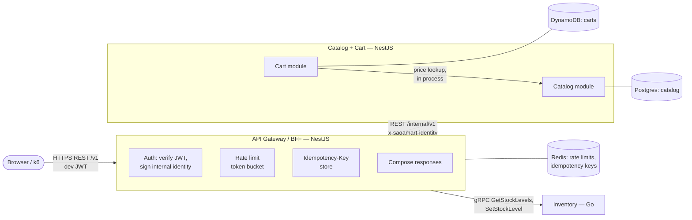
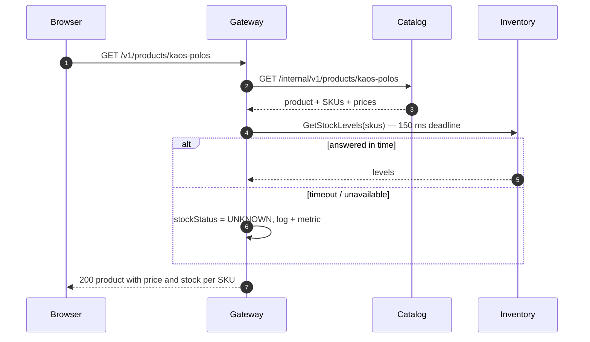

# RFC-0005: Catalog, Cart and API Gateway

| | |
|---|---|
| **Author** | Rizky |
| **Status** | In review |
| **Created** | 2026-10-22 |
| **Stage** | 1 First slice |
| **Related** | PRD [FR-01, FR-03, FR-04, FR-11, J1, J2, J5](../product/prd.md), [System Design §3, §7](../architecture/system-design.md), [Context Map](../architecture/context-map.md), [ADR-0002](../adr/0002-polyglot-service-languages.md), [ADR-0004](../adr/0004-database-per-service.md), [ADR-0007](../adr/0007-cart-in-dynamodb.md), [RFC-0001](0001-inventory-reservation.md), issue #17 |

## 1. Summary

Build the two NestJS services that complete the First slice: **Catalog + Cart** (products, SKUs, categories, prices and carts) and the **API Gateway / BFF** (the public REST API, development authentication, the signed internal identity, rate limiting and idempotency). Together with Inventory they give a working browse → product detail with live stock → cart API, plus admin product and stock management.

## 2. Motivation

The MVP requires FR-01 (list and filter products), FR-03 (product detail with live stock), FR-04 (guest and signed-in carts with a 7-day TTL) and FR-11 (admin CRUD for products and stock). Stage 2's checkout saga needs a cart to check out and a gateway to call it through. Inventory's `SetStockLevel` is open to any caller until the gateway defines the signed identity that services verify (#17).

## 3. Goals and non-goals

**Goals**

- Public REST API `/v1` behind the gateway, specified in OpenAPI before it is built.
- Products with variants (SKUs) and categories; cursor-paginated listing filtered by category and price.
- Product detail and cart views with live availability from Inventory, degrading to "unknown" if Inventory is slow or down (RFC-0001 decision log).
- Guest and signed-in carts in DynamoDB with a 7-day sliding TTL; the cart shows current price and availability and flags changes (J2).
- Admin product and stock management, with the admin role checked at the gateway **and** in the owning service.
- A signed internal identity that every service can verify, which unblocks #17.

**Non-goals**

- Full-text search (FR-02, Core complete) and catalog events for the search indexer (Stage 3, RFC-0003).
- Merging a guest cart on sign-in (FR-05, Core complete).
- Real OIDC (Core complete); a development JWT stands in, as the PRD allows.
- Checkout (Stage 2, RFC-0002) and the web app (`apps/web`).
- Image upload: products carry image URLs only.

## 4. Proposed design

### 4.1 Overview



- **The gateway is a BFF, not a proxy.** It owns no business data, but it composes responses: product and cart views merge Catalog data with Inventory availability, so the browser makes one call per screen.
- **Catalog and Cart are separate contexts in one deployable** (context map). They are separate NestJS modules with separate stores; the Cart module reads prices only through the Catalog module's exported service.
- **Internal protocols:** Catalog exposes internal REST (CRUD and queries, cache-friendly, NestJS's strength). Inventory keeps gRPC. System Design §4 reserves gRPC for saga commands, and this RFC follows that; the planned ADR on gRPC vs REST (Stage 2) will record the rule.

### 4.2 API and contract changes

All contracts are written in `contracts/` **before** the code (development process §4).

**Public API** — `contracts/openapi/public-v1.yaml`, served by the gateway. JSON fields are camelCase, money is `{ "amount": 150000, "currency": "IDR" }`, errors are RFC 9457 Problem Details (conventions §4).

| Method and path | Who | Purpose |
|---|---|---|
| `GET /v1/categories` | anyone | Category tree |
| `GET /v1/products?category=&minPrice=&maxPrice=&sort=&limit=&cursor=` | anyone | FR-01. `sort` is `newest` (default), `price_asc` or `price_desc`; `limit` 1–50 (default 20); opaque `cursor`, `nextCursor` null at the end. Each item has a product-level `stockStatus`. |
| `GET /v1/products/{slug}` | anyone | FR-03. Product with its SKUs; each SKU has `price`, `available` and `stockStatus` (`IN_STOCK`, `LOW_STOCK` at ≤ 5, `OUT_OF_STOCK`, or `UNKNOWN` when Inventory didn't answer in time) |
| `GET /v1/cart` | buyer or guest | FR-04. The current cart: lines with `quantity`, `priceSnapshot`, current `price`, `priceChanged`, `available`, `exceedsAvailable`, and a `total` |
| `PUT /v1/cart/lines/{sku}` `{ "quantity": n }` | buyer or guest | Set a line's quantity, adding the line if needed; `0` removes it. Idempotent by method, so no `Idempotency-Key`. |
| `DELETE /v1/cart/lines/{sku}` | buyer or guest | Remove a line |
| `POST /v1/admin/products` | admin | Create a product with its SKUs (`Idempotency-Key` required) |
| `PATCH /v1/admin/products/{id}` | admin | Edit fields; `If-Match: "<version>"` required, `412` on a stale version |
| `POST /v1/admin/products/{id}/skus` | admin | Add a variant (`Idempotency-Key` required) |
| `PATCH /v1/admin/skus/{sku}` | admin | Change a variant's price or name; `If-Match` required |
| `PUT /v1/admin/skus/{sku}/stock` `{ "onHand": n, "expectedVersion": v }` | admin | FR-11. Calls Inventory `SetStockLevel`; Inventory's `VERSION_CONFLICT` becomes `409` |
| `POST /v1/dev/token` `{ "role": "buyer" \| "admin", "userId"? }` | anyone, **dev only** | Issues a development JWT. Exists only when `GATEWAY_DEV_AUTH=true`, and the gateway refuses to start with it in `prod`. |

**Guest carts.** `GET /v1/cart` without a cart creates nothing. The first `PUT` from a guest creates the cart and returns an `X-Cart-Token` response header: 128 random bits, base64url. The client sends it back on later cart calls. Signed-in buyers' carts are keyed by user ID and need no token.

**Internal Catalog API** — `contracts/openapi/catalog-internal-v1.yaml`, under `/internal/v1`, reachable only on the internal network. It mirrors the public operations without composition: `products`, `products/{slug}`, `categories`, `skus:lookup` (prices and names for up to 100 SKUs; Order will use it in Stage 2), `carts/{cartKey}`, `carts/{cartKey}/lines/{sku}`, and the admin writes.

**Internal identity** — `contracts/identity.md`, a new contract. The gateway authenticates the caller, then sends every internal request with:

```http
x-sagamart-identity: <compact JWS>
```

- **Algorithm:** `EdDSA` (Ed25519). The gateway holds the private key; each service has only the public key, so a compromised service cannot mint identities for others.
- **Claims:** `iss: "gateway"`, `aud: "<target service>"`, `sub` (user ID, absent for guests), `roles` (`["buyer"]`, `["admin"]` or `[]`), `iat`, `exp` = `iat` + 60 s, and `jti`.
- **Carried as:** an HTTP header to Catalog and gRPC metadata to Inventory.
- **Services must** verify the signature, `aud` and `exp` (allowing 5 s clock skew), and reject a missing or invalid identity on protected operations with `401` / `UNAUTHENTICATED`. Admin operations also require `admin` in `roles` (`403` / `PERMISSION_DENIED`).
- **Inventory (#17):** `SetStockLevel` requires `admin`. The saga RPCs will instead require an `order` service identity, defined in RFC-0002.

### 4.3 Data model

**Catalog — Postgres** (`catalog-db`), TypeORM migrations in `services/catalog/src/migrations/`.

```sql
CREATE TABLE categories (
    id        UUID PRIMARY KEY,
    slug      TEXT NOT NULL UNIQUE,
    name      TEXT NOT NULL,
    parent_id UUID REFERENCES categories (id),
    position  INT NOT NULL DEFAULT 0
);

CREATE TABLE products (
    id           UUID PRIMARY KEY,
    slug         TEXT NOT NULL UNIQUE,
    name         TEXT NOT NULL,
    description  TEXT NOT NULL DEFAULT '',
    category_id  UUID NOT NULL REFERENCES categories (id),
    image_urls   TEXT[] NOT NULL DEFAULT '{}',
    status       TEXT NOT NULL CHECK (status IN ('DRAFT', 'ACTIVE', 'ARCHIVED')),
    min_price    BIGINT,          -- lowest active SKU price, maintained with SKU writes; drives price filter and sort
    version      INT NOT NULL DEFAULT 1,
    created_at   TIMESTAMPTZ NOT NULL DEFAULT now(),
    updated_at   TIMESTAMPTZ NOT NULL DEFAULT now()
);
CREATE INDEX products_listing_newest ON products (category_id, created_at DESC, id DESC) WHERE status = 'ACTIVE';
CREATE INDEX products_listing_price  ON products (category_id, min_price, id) WHERE status = 'ACTIVE';

CREATE TABLE skus (
    sku          TEXT PRIMARY KEY,                 -- same code Inventory uses
    product_id   UUID NOT NULL REFERENCES products (id),
    name         TEXT NOT NULL,                    -- the variant label, e.g. "M / Black"
    price_amount BIGINT NOT NULL CHECK (price_amount > 0),
    currency     CHAR(3) NOT NULL DEFAULT 'IDR' CHECK (currency = 'IDR'),
    status       TEXT NOT NULL CHECK (status IN ('ACTIVE', 'ARCHIVED')),
    version      INT NOT NULL DEFAULT 1,
    created_at   TIMESTAMPTZ NOT NULL DEFAULT now(),
    updated_at   TIMESTAMPTZ NOT NULL DEFAULT now()
);
CREATE INDEX skus_by_product ON skus (product_id);
```

- **Cursors** are opaque base64url of the sort key plus `id` (for example `{"s":"newest","t":"2026-10-22T...","id":"..."}`). They use keyset pagination, so pages stay stable while products are added. A cursor from a different sort or filter is rejected with `400`.
- **SKU codes** follow the conventions for Inventory SKUs (≤ 64 characters, no whitespace). Creating a SKU in Catalog does not create stock; stock starts when an admin sets it.

**Cart — DynamoDB** (`carts` table, ADR-0007 single-table design):

| PK | SK | Attributes |
|---|---|---|
| `CART#<cartKey>` | `META` | `ownerType` (`user` or `guest`), `updatedAt`, `ttl` |
| `CART#<cartKey>` | `LINE#<sku>` | `quantity`, `priceSnapshot`, `addedAt` |

- **Cart keys:** `cartKey` is `user:<userId>`, or `guest:<sha256(token)>` so a leaked table never exposes guest tokens.
- **TTL:** every write refreshes `ttl` (now + 7 days) on `META` and the touched line in one `TransactWriteItems`. DynamoDB's TTL deletes expired items; reads also treat `ttl < now` as absent, because TTL deletion is lazy.
- **Limits:** at most 50 lines per cart (a condition on a line counter in `META`), quantity 1–100 per line.
- **Price snapshot:** written when a line is added or its quantity changes, from Catalog's current price. The authoritative price is re-read at checkout (context map).

**Gateway — Redis:** rate-limit buckets and idempotency records only. Nothing durable.

### 4.4 Key flows

**Product detail (FR-03)**



**Product list (FR-01):** the same shape. Catalog returns the page, and the gateway asks Inventory for all of the page's SKUs in one `GetStockLevels` call (a page of ≤ 50 products is capped at 100 SKUs; any extra SKUs go in a second call). A product's `stockStatus` is the best of its SKUs'.

**Cart view (J2):** Catalog returns the cart lines with current prices from the Catalog module in the same process, and the gateway adds availability. A line gets `priceChanged` when the current price differs from the snapshot, and `exceedsAvailable` when its quantity is above what's available. Nothing is reserved until checkout (Stage 2).

**Admin stock change (FR-11):** the gateway checks the admin role, then calls Inventory's `SetStockLevel` with the identity in gRPC metadata. Inventory checks the role again (#17).

**Idempotent admin writes:** for `POST` with an `Idempotency-Key`:

1. The gateway stores `{status, headers, body}` in Redis under `idem:<userId>:<route>:<key>` for 24 hours (conventions §4).
2. A retry with the same key and the same request body gets the stored response.
3. The same key with a different body gets `422`.
4. A retry while the first request is still running gets `409`, enforced by a `SET NX` lock.

### 4.5 Failure modes

| Failure | Detection | Behaviour | Recovery |
|---|---|---|---|
| Inventory slow or down | `GetStockLevels` misses its 150 ms deadline | Pages render with `stockStatus: UNKNOWN`; `sagamart_gateway_stock_unknown_total` counts it. Admin stock changes return `503`. | Automatic once Inventory answers |
| Catalog down | Gateway's request fails or its circuit breaker is open | `503` Problem Details with `Retry-After` for browse, cart and admin | Breaker half-opens after 10 s |
| DynamoDB down | Catalog's cart call fails | Cart endpoints `503`; browsing unaffected | Automatic |
| Redis down | Rate-limit or idempotency call fails | Rate limiting **fails open** (allow and log). Admin `POST`s **fail closed** (`503`), because without the store a retry could create a duplicate. | Automatic |
| Invalid or expired JWT | Verification fails | `401`; admin route without the admin role is `403` | Get a new token |
| Stale admin edit | Version mismatch | `412` (Catalog) or `409` (stock) with the current version in the body | Re-read and retry |
| A cart above 50 lines | Conditional write fails | `422` `CART_LINE_LIMIT` | — |

### 4.6 Concurrency and consistency

- **Product and SKU edits** use optimistic concurrency on `version` (`If-Match`). A lost update is impossible, and conflicts are rare enough that retrying is the client's job.
- **`min_price`** is recomputed in the same transaction as any SKU price or status change, so listings never filter on a stale price.
- **Two concurrent writes to one cart line:** last writer wins, which is fine for a cart. The line counter in `META` uses a conditional update, so concurrent adds can't exceed 50 lines.
- **Stock shown on product pages and in carts is a snapshot.** It can be stale by the time a buyer checks out; Inventory's reservation at checkout is the authority (RFC-0001).
- **Idempotency records** are per user, so two users can't collide on a key.

## 5. Alternatives considered

| Alternative | Why not |
|---|---|
| Gateway as a thin reverse proxy, with the browser calling Inventory for stock | Two round trips per screen from the browser, Inventory's API exposed publicly, and no single place to degrade gracefully |
| GraphQL at the gateway | Flexible, but caching, rate limiting and Problem Details errors are harder, and the screens are few and known |
| gRPC from gateway to Catalog | Typed and fast, but Catalog is CRUD and queries; REST keeps it cache-friendly and matches System Design §4's rule (gRPC for saga commands) |
| HMAC (shared-secret) identity header | Simpler key handling, but any service holding the secret could mint an admin identity. Ed25519 limits minting to the gateway at little extra cost. |
| Cart in Postgres or Redis | Decided in ADR-0007 |
| Next.js API routes as the BFF | Couples the API to the web app; k6, admin tooling and later clients need the same API |

## 6. Observability

- **Both services:** OpenTelemetry auto-instrumentation for HTTP, pg, the AWS SDK (DynamoDB), ioredis and gRPC. Logs with `pino` via `nestjs-pino` using the conventions §7 fields, plus `/healthz`, `/readyz` and `/metrics`.
- **Tracing:** `traceparent` flows from browser to gateway to Catalog and Inventory, so a product page is one trace.
- **Gateway metrics:** RED per route (`sagamart_gateway_http_requests_total`, `..._request_duration_seconds`), `stock_unknown_total`, `rate_limited_total`, `idempotency_replays_total`, and circuit-breaker state.
- **Catalog metrics:** RED per internal route, cart writes by outcome, and DynamoDB latency.
- **Dashboard:** "Browse and cart": request rate and p99 per route, the stock-unknown rate, and Catalog and DynamoDB latency.

## 7. Performance and capacity

PRD targets: product list and detail **p99 < 200 ms** at target load, and browsing keeps working while Order and Payment are down. A new `deploy/k6/browse.js` measures 500 VUs on a read-heavy mix (list 50%, detail 35%, cart 15%) and records the result in `docs/benchmarks/`. No cache is added up front. If the target isn't met, the first lever is a short Redis cache of Catalog's list and detail responses (not stock), recorded in an ADR.

## 8. Security and privacy

- **Development JWT:** HS256 with `GATEWAY_DEV_JWT_SECRET`, one-hour expiry, roles `buyer` or `admin`. The issuing endpoint exists only when enabled, and the gateway refuses to start with it in `prod`. It is replaced by OIDC at Core complete; the internal identity format does not change.
- **Admin role** is checked twice: at the gateway, and again in Catalog and Inventory using the signed identity. A request that reaches a service directly, bypassing the gateway, has no valid identity.
- **Guest cart tokens** are 128-bit random capabilities, stored only as SHA-256 hashes.
- **Rate limits:** token buckets per IP (anonymous) and per user, 20 requests/s with a burst of 40, configurable. A `429` carries `Retry-After`.
- **Input:** validated with DTOs and `class-validator`, with sizes capped (names 200 characters, descriptions 5,000, 10 image URLs). Problem Details never include stack traces or SQL.
- **Personal data:** none beyond user IDs. No names, addresses or payment data in this slice.

## 9. Testing plan

- **Unit (test-first):** cursor encoding and validation, cart rules (limits, TTL refresh, price-change flags), stock-status mapping, the idempotency state machine, identity sign and verify (expired, wrong audience, wrong key), and token-bucket arithmetic.
- **Integration (Testcontainers):**
  - Catalog against Postgres: listing order and filters across page boundaries, `min_price` maintenance, optimistic concurrency.
  - Catalog against DynamoDB Local: cart TTL, the 50-line limit under concurrent adds.
  - Gateway against Redis: idempotency replay and concurrent duplicates.
  - Inventory: Go tests for identity verification (#17).
- **Contract:** gateway and Catalog responses validated against their OpenAPI specs in tests; the gateway's Catalog client is generated from `catalog-internal-v1.yaml`.
- **End to end:** a flow test on the Compose stack: dev token → admin creates a product and sets stock → buyer lists, opens and adds to cart → the cart shows the price and availability. Then the same with Inventory stopped (`stockStatus: UNKNOWN`), which also covers chaos experiment C6's browsing half.
- **Load:** `browse.js` as in section 7.

## 10. Rollout plan

Each step is its own issue and PR, roughly in order:

1. **Contracts:** `public-v1.yaml`, `catalog-internal-v1.yaml` and `identity.md`, with OpenAPI linting in CI.
2. **Shared Node tooling:** a pnpm workspace with `packages/node-common` (logger, OTel setup, config validation, Problem Details, identity sign and verify) and Node CI jobs.
3. **Catalog skeleton:** config, health, metrics, migrations, Dockerfile, Compose.
4. **Catalog products and categories:** model, listing with cursors and filters, detail, admin writes.
5. **Cart module:** the DynamoDB table and the cart API.
6. **Gateway skeleton:** dev JWT, identity signing, rate limiting, Problem Details.
7. **Gateway composition:** browse, product detail and cart with Inventory stock, including the 150 ms degradation.
8. **Gateway admin:** product writes with idempotency, and stock via Inventory.
9. **Inventory identity check (#17).**
10. **End-to-end flow test and the `browse.js` benchmark.**

Nothing outside these services changes. Each step merges independently.

## 11. Open questions

- [ ] **JS workspace tooling:** pnpm workspaces with a shared `packages/node-common` (proposed), or npm workspaces? Either needs a `packages/` folder, which conventions §1 doesn't have yet.
- [ ] **Guest cart token transport:** the `X-Cart-Token` header (proposed; the future web app can keep it in an httpOnly cookie on its own side), or a cookie set by the gateway now?
- [ ] **Catalog events:** publish `catalog.product.*` through an outbox in Stage 1 even though nothing consumes them until Stage 3, or add them with RFC-0003 (proposed)?
- [ ] **`LOW_STOCK` threshold:** a fixed 5 units (proposed), or configurable per product?

## 12. Decision log

| Date | Decision | Notes |
|---|---|---|
| 2026-10-22 | Draft opened | |
